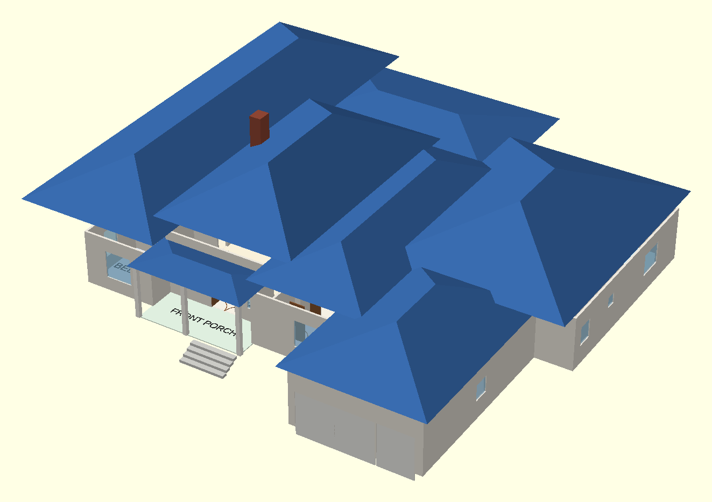

# house

OpenSCAD models of the house. Units are feet; visualisation only, not
construction documents. See [REVIEW.md](REVIEW.md) for the plan and model
review and Kayla's notes.



| File | What |
|---|---|
| `main_floor.scad` | Main level, measured off the architect's plan: rooms, doors, windows, kitchen and bath fixtures, porches, hipped roof |
| `basement.scad` | Lower level from the hand-drawn sketch: theater, pool + hot tub + pool bath, utilities, rec room / library, music room, exit stair, foundation |
| `house_combined.scad` | Both levels stacked (`use`s the two files above) |
| `house_lib.scad` | Shared modules and the basement alignment |
| `tools/check_layout.py` | Optional layout checker (needs `openscad` on `PATH`) |

## Options

Set them in the OpenSCAD Customizer or with `-D name=value`:

- `changes`: `true` shows the proposed changes from Kayla's review (new
  doors drawn green, kitchen work zone, central bedroom hall, master
  laundry, kitchen-to-dining hall, bigger shower);
  `false` shows the plan as drawn.
- `stair`: `"proposed"` puts the basement stair in the former bar so both
  floors meet; `"as_drawn"` keeps each drawing's stair (they don't line up).
- `show_roof`, `roof_opacity`, `roof_color`: the roof (blue by default).
- `mode` (combined only): `assembled`, `exploded`, `basement_only` or
  `main_only`; `show_ground` draws the lawn at grade in the assembled view.

## Editing

Each floor is a set of tables at the top of its file, e.g. in
`main_floor.scad`:

- `main_rooms()`: `[label, x0, y0, x1, y1, ceiling, kind, ...]`
- `main_doors()`: `[x, y, axis, width, type, swing, ...]`
- `main_windows()`

x runs east and y north; on the main floor x = 0 is the garage's west wall
and y = 0 the front wall of the dining room and lounge. Every format is
described at the top of `house_lib.scad`. After editing, run the checker:

```bash
python3 tools/check_layout.py
```

Rendering from the command line, e.g. the main-floor plan:

```bash
openscad -o plan.png --imgsize=2000,1300 --viewall --autocenter \
  --projection=o --camera=0,0,0,0,0,0,0 -D show_roof=false main_floor.scad
```
