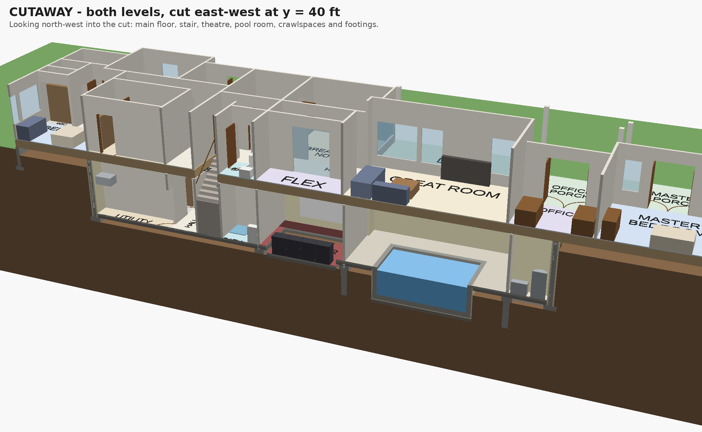
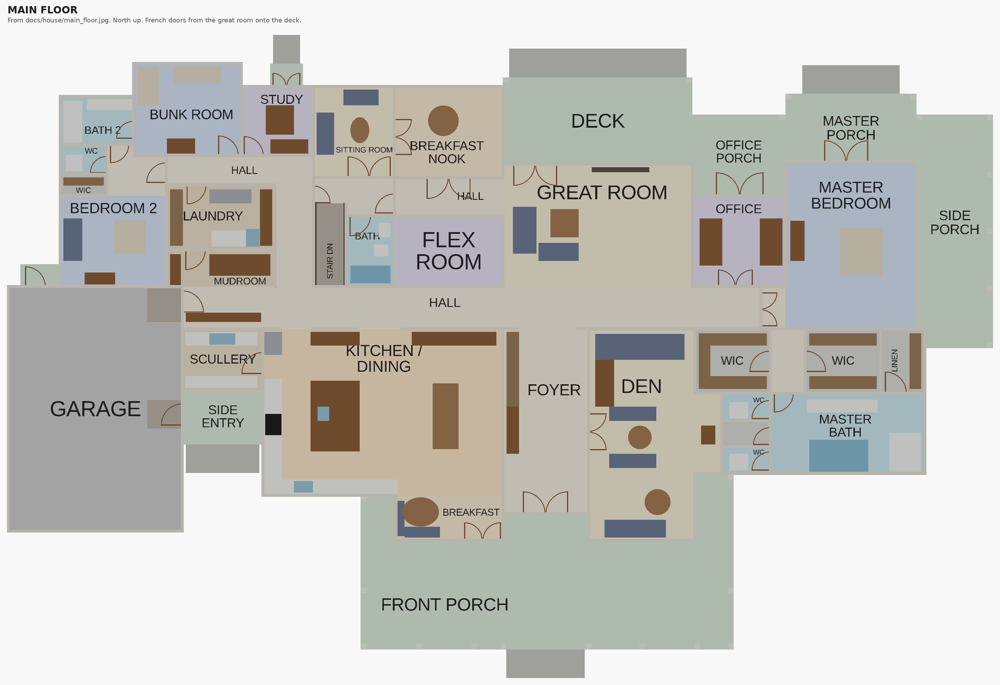
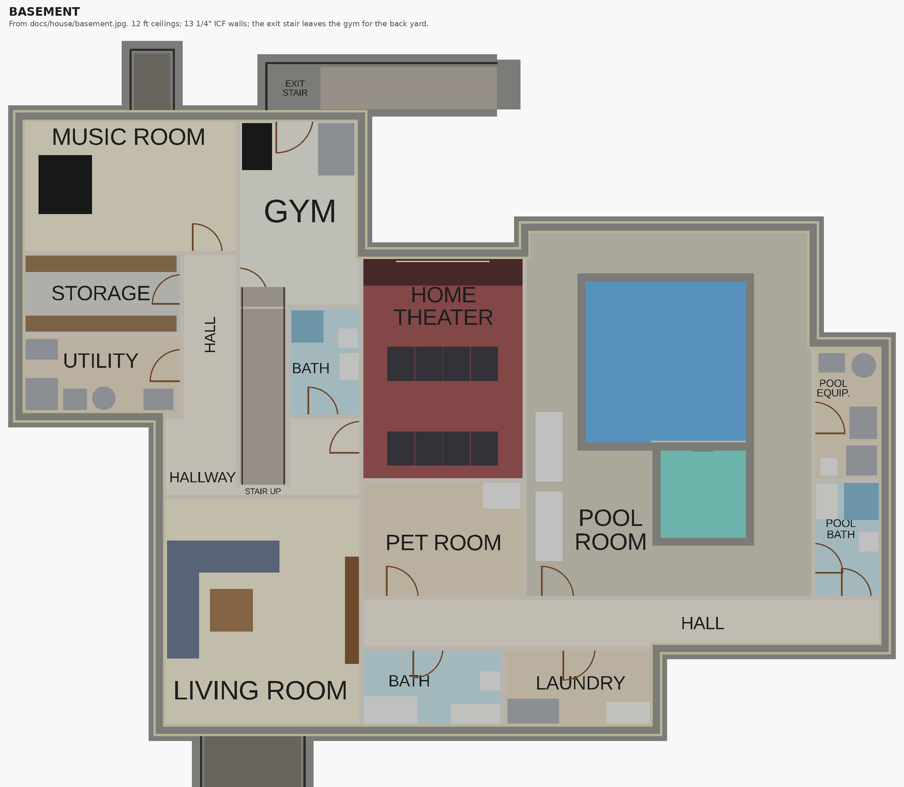
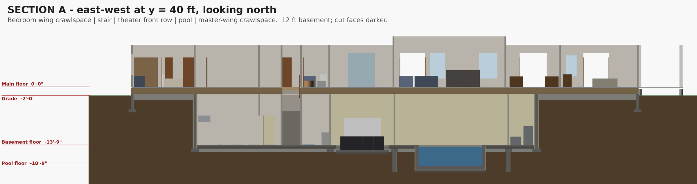
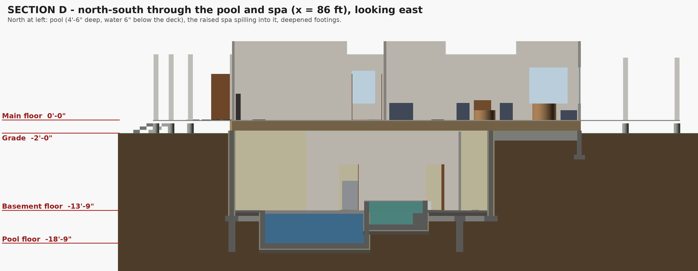

# house

OpenSCAD models of the house, the shop and the site. Units are feet;
visualisation only, not construction documents.

The house was redesigned in November 2026. The new plans are
[`docs/house/main_floor.jpg`](docs/house/main_floor.jpg) and
[`docs/house/basement.jpg`](docs/house/basement.jpg). See
[`docs/house/Redesign-and-Spec-2026-11-02.md`](docs/house/Redesign-and-Spec-2026-11-02.md)
for:

- how the plans became the model, and what changed;
- the stair between the floors;
- the foundation;
- the concrete for the indoor pool and its hot tub;
- the stadium-tiered theater floor;
- the basement exit stair;
- the open questions.

**Engineering and permits:**
[`docs/permit/`](docs/permit/README.md) is the hand-off package for the
engineer. It holds:

- a 14-sheet drawing set (PDF), generated from the model;
- the plans as DXF files;
- the door, window and room schedules;
- the engineering brief;
- the Alberta permit roadmap and checklist.

Read its §1 first: the house is over the 600 m² size limit for Part 9 of
the building code as drawn.



| File | What |
|---|---|
| `models/main_floor.scad` | Main level from `main_floor.jpg`: rooms, doors, windows, kitchen and bath fixtures, furniture, porches, hipped roof, the floor framing |
| `models/basement.scad` | Lower level from `basement.jpg`, with 12 ft ceilings: music room, gym, theater, pool + spa + pool bath, pet room, living room, utility, laundry, the exit stair up to the back yard, and windows in two light wells |
| `models/foundation.scad` | The concrete: ICF basement walls and footings, slab, theater tiers, pool + spa shells, the exit stair's areaway, frost walls, garage slab, porch piers, and the earth for sections |
| `models/house_combined.scad` | Everything together (it `use`s the files above): assembled, exploded, foundation and section views |
| `models/house_lib.scad` | Shared modules, the floor-to-floor height and the stair |
| `models/shop.scad` | The 100 × 100 ft 4-bay shop (behind the house, Bay 1 utilities southernmost) with pull-through doors on the two truck bays and the wash bay (3 bays, 6 doors), the pit, the wash-bay drain and the Bay 1 utility rooms |
| `models/site.scad` | The property. `phase = "house"` (the default) shows the house first, with what it needs: the driveway from the road on the south, the power / gas / fibre corridor, a propane tank option, Starlink, the well on the west side, and the septic tank and field on the east side. The future shop's spot is dashed. `phase = "full"` adds the shop, its wrap-round drive and tree belt, and the buried service lines from the house. There is no tunnel any more |
| `models/export.scad` | Echoes every table of the model, one per line, for the tools |
| `tools/check_layout.py` | Layout checker (needs `openscad` on `PATH`) |
| `tools/model_data.py` | Reads the model's tables through `models/export.scad` |
| `tools/make_drawings.py` | Writes the drawing set, DXF plans and schedules into `docs/permit/` (needs `openscad`, matplotlib, shapely, ezdxf) |

Research and planning documents live in `docs/`:

- `docs/house/` has the plans, the redesign notes and spec, and the renders.
- `docs/permit/` has the engineering review and permit package.
- `docs/House-Review-and-Research-2026-10-28.md` is the earlier house review
  and build research for Alberta.
- `docs/shop/` has the shop base plan, with its drawn plans and renders.
  The shop is a later, separate project. The plan's utility-hub and tunnel
  ideas are superseded (see its Nov 3 note).

| | |
|---|---|
|  |  |
|  |  |

## Options

Set them in the OpenSCAD Customizer or with `-D name=value`.

`house_combined.scad`:

- **`mode`**:
  - `assembled`: the house on its lot.
  - `exploded`: the main floor lifted off the basement; `explode_gap` sets
    the distance.
  - `basement_only`, `main_only`.
  - `foundation`: the concrete alone.
  - `section`: a vertical cut through everything, earth included.
- **`section`** (with `mode="section"`):
  - `A`: east-west through the stair, theater and pool.
  - `B`: along the stair.
  - `C`: through the theater.
  - `D`: through the pool and spa.
  - `E`: along the basement exit stair.
  - `custom`: set `cut_axis` (`x`/`y`) and `cut_at` yourself.

  Cut faces are drawn darker than the surfaces beyond them.
- **`show_roof`, `roof_opacity`, `roof_color`**: the roof (blue by
  default). Section views leave the roof out unless `section_roof=true`.
- **`show_furniture`**, and **`show_ground`** (the lawn in the assembled
  view).

`site.scad`:

- **`phase`**: `house` (the house and its services, built first) or
  `full` (with the future shop).

`foundation.scad`:

- **`part`**: `all`, `basement` or `frost`.
- **`show_earth`**: draw the earth around it.

## Editing

Each floor is a set of tables at the top of its file. In
`models/main_floor.scad`:

- `main_rooms()`: `[label, x0, y0, x1, y1, ceiling, kind, ...]`
- `main_doors()`: `[x, y, axis, width, type, swing, ...]`
- `main_windows()`, `main_fixtures()`, `main_furniture()`

The coordinates:

- Both floors use the same frame, in feet. x runs east and y north; x = 0
  is the garage's west wall and y = 0 the front wall of the den and the
  breakfast bay.
- z = 0 is the main floor. The basement floor is `floor_to_floor()`
  (13.75 ft, for 12 ft ceilings) below it.
- Every table format is described at the top of `models/house_lib.scad`.

After editing, run the checker:

```bash
python3 tools/check_layout.py
```

It checks:

- every door joins the rooms it should;
- every leaf swings clear of walls, fixtures and other leaves;
- every room is reachable;
- rooms neither overlap nor leave slivers between them.

Rendering from the command line (from `models/`), e.g. the main-floor plan
and section A:

```bash
openscad -o plan.png --imgsize=3600,2300 --projection=o \
  --camera=69,25.7,0,0,0,0,235 -D show_roof=false main_floor.scad
openscad -o section_a.png --imgsize=3000,1000 --projection=o \
  --camera=69,40,-4,90,0,0,190 -D 'mode="section"' -D 'section="A"' house_combined.scad
```

For sections B–D, look east with `--camera=<x>,25,-4,90,0,270,150`;
for E, look north with `--camera=57,65.75,-7,90,0,0,70`.
Sections take a minute or two each: every cut face is computed exactly.

The drawing set is regenerated, after any change to the model, with:

```bash
python3 tools/make_drawings.py
```

It renders the elevations, sections, roof and site views with OpenSCAD
and caches them in `build/` (ignored by git) until a model file changes.
Then it draws every sheet from the model's tables.
