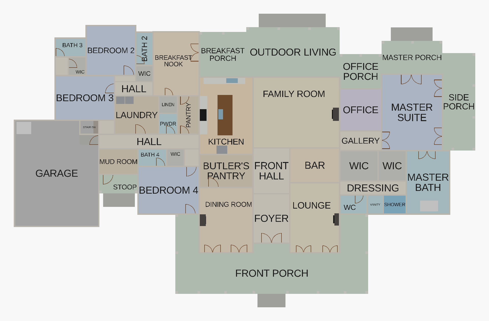
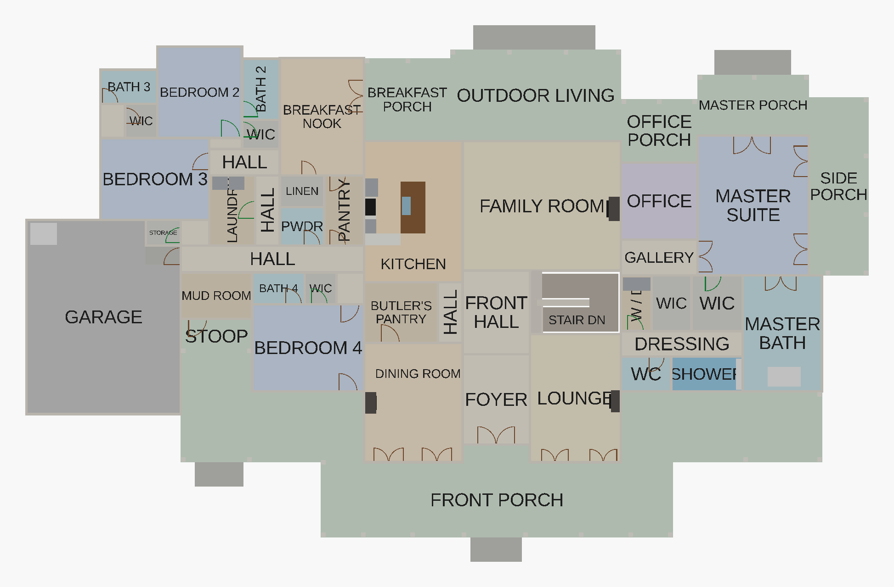
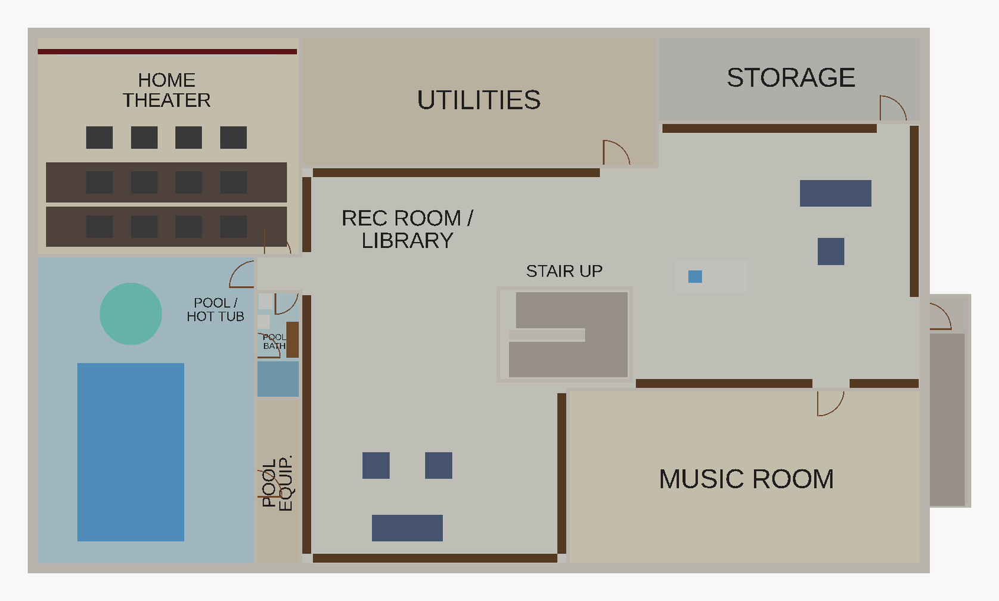
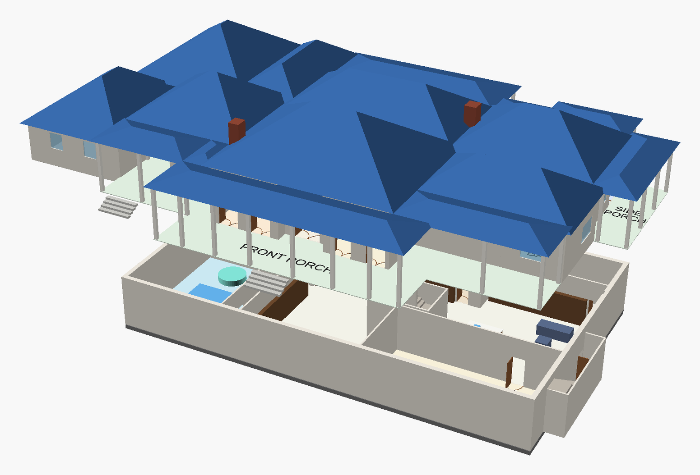
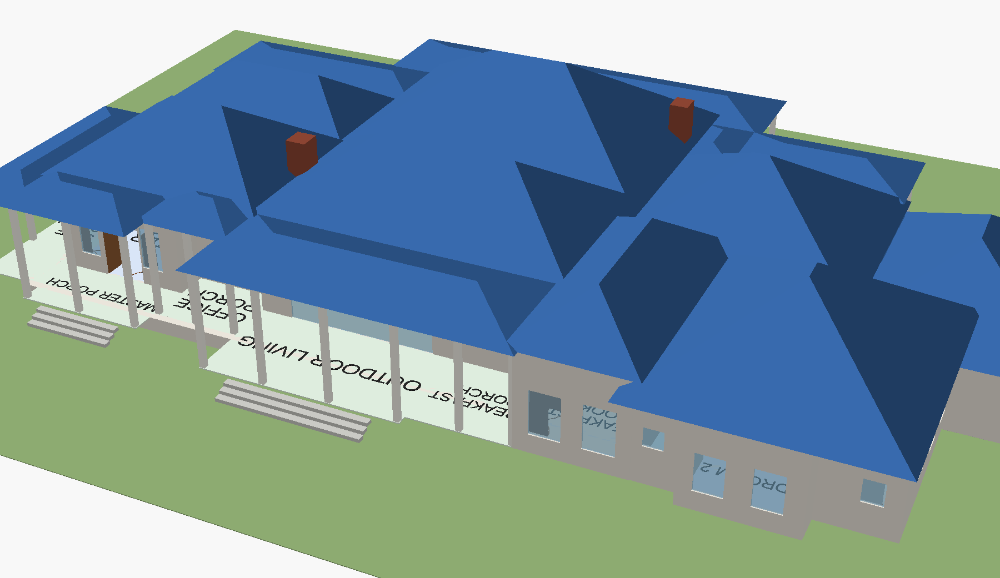

# House review: plans, OpenSCAD models and Kayla's notes

October 2026. Reviewed: the architect's main-floor plan, the hand-drawn
basement sketch, the OpenSCAD models as of `c28a5f8`, and Kayla's notes.

## Summary

- **The old models had serious layout bugs.** From the foyer you could only
  walk to the front hall, kitchen and family room. Every other room was
  reachable only from outside, through a gap with no floor, or not at all.
  Eight doors were cut through windows.
- **The main floor is rebuilt from measurements of the plan.** The old model
  used the printed room sizes as wall-to-wall boxes, but those are clear sizes,
  and for open rooms just the seating area. It came out about 20% too small
  (about 4,300 vs about 5,300 sq ft of rooms, measured at wall centre lines)
  and missed the plan's front setbacks and halls.
- **All of Kayla's notes are in the model.** They are switchable, so you can
  compare before and after (`changes = true / false`). New doors are drawn
  green.
- **The stairs in the two drawings can't meet.** Decided: the basement
  stair goes where the bar is (option A, section 2).
- **The code is now table-driven.** One row per room, door and window; the
  combined model reuses the level files instead of copying them; and a
  checker catches layout bugs like the ones above.

## 1. Kayla's notes: what changed

| Note | In the model (`changes = true`) |
|---|---|
| *Add a door from bedroom to closet directly so you don't have to go through the bathroom* | New doors (green): **master suite → master closet**, **Bedroom 2 → its closet**, **Bedroom 4 → its closet**. The old through-the-bath openings into the Bedroom 2 and 4 closets are closed, so those closets keep their shelving walls. The master closets also still open to the dressing area by the master bath. Bedroom 3's closet already opens off its own little vestibule, so it's unchanged. |
| *Kitchen layout needs tweaking, 2 paths of travel through work zone* | As drawn, the island sits between both kitchen entrances, so people coming from the bedrooms/nook and from the garage hall both walk through the cooking aisle. Now there is **one cooking aisle**: the range wall and the island sink, 4 ft apart. A counter return closes the aisle at the south end, and the fridge and wall ovens sit at its open north end. Through-traffic gets its own lanes: north of the work zone (nook ↔ family room) and south of it (garage hall / butler's pantry ↔ family room). |
| *Access the laundry room from both sides* | Round 1 gave the laundry a second door so it worked as a pass-through. Round 2 replaces that with a **central hall** beside the laundry (see below). |
| *I like all the porches* | All kept: front (wraps around the front rooms), breakfast, outdoor living, office, master and side, plus the mud-room stoop. They join up as one continuous back porch, with steps down to the yard. |
| *I want a bigger shower* | Master shower grows from about **7 × 5½ ft to about 11½ × 5½ ft** (it takes the makeup-vanity niche next to it) and gets a bench. |
| *The 3D model is cool and the roof looks nice*; *maybe a blue roof so it's not as hot as black* | The hipped roof is back in the model, with chimneys for the two wood fireplaces. It is **blue** by default (`roof_color`); `show_roof = false` or a lower `roof_opacity` lets you see inside. On "cooler than black", see [the roof note](#roof-colour-and-heat). |

| As drawn (`changes = false`) | With the changes |
|---|---|
|  |  |

### Round 2: hall, laundries, kitchen, dining, basement

| Note | In the model (`changes = true`) |
|---|---|
| *Get to Bedrooms 2 & 3 from a central hallway, not through the laundry* | The east end of the old laundry is now a **4 ft hall** that runs straight from the main hall by the kitchen and mud room into the end of the bedroom hall (Bedrooms 2 and 3, Bath 2). Its east wall continues the breakfast nook's wall, so it lines up with the bedroom hall instead of jogging past it. Both ends are full-height openings. The powder room and linen closet take the leftover 1.7 ft. |
| *That laundry becomes the extra one for those three bedrooms* | The laundry keeps its washer and dryer, gets about 7½ × 11½ ft, and has one door off the new hall. It is no longer a through-route. |
| *Master suite gets its own laundry with the walk-in closet and the bathroom* | The west 5 ft of the master closet becomes a **master laundry** (labelled W / D) with a side-by-side washer and dryer. Its door opens off the dressing area, between the closets and the master bath. The walk-in closet keeps its door from the master suite. |
| *Breakfast nook: outside to the deck (it does) and access to the kitchen* | The deck door stays. The nook-to-kitchen opening is widened to **5 ft** and lands at the north end of the work aisle. |
| *Don't like going through the butler's pantry to get to the dining room* | The butler's pantry is 4 ft shorter. That frees a **4 ft hall from the kitchen straight to the dining room**, with full-height openings at both ends. The pantry is still next to the dining room, but you no longer walk through it. |
| *Don't love the path of travel between the fridge and the rest of the kitchen* | The **fridge moves onto the range wall** at the north end of the aisle and faces the island. The wall ovens move to the south end of the same wall. Fridge, range, ovens and island sink now all face one 4 ft aisle, and no walkway crosses between them. The north wall is left clear for the walk-through to the nook. |
| *Basement flex room becomes a music room* | Renamed **MUSIC ROOM**. Plan for sound isolation, because it sits beside the library. |
| *Small bar / coffee station in the middle of the rec room with a small sink and dishwasher* | An island of about **8 × 3½ ft** stands in the open part of the rec room, east of the stair. It has a bar sink and a 24" dishwasher. The old bar counter along the wall is gone. |
| *All rec-room walls full of bookshelves, a library, with some seating* | **7 ft bookshelves** line every solid rec-room wall, leaving door openings clear. There are two reading groups: a sofa with two chairs in the south bay, and a sofa with a chair near the coffee station. The room is labelled REC ROOM / LIBRARY. |

### Round 3: from the build research (Oct 28)

| Research item | In the model |
|---|---|
| *No basement bathroom* (decision A3, a before-the-pour rough-in) | A **pool bath** of about 5 × 12 ft, taken from the north end of the pool-equipment strip. Swimmers reach it straight from the pool room, and it has a second door from the vestibule on the rec-room side, so the theater and library can use it too. Inside: a shower at the south end, a change bench, a sink and a WC. The pool-equipment room is now 5 × 19 ft (about 95 sq ft) with its door off the pool room. |
| *ICF: plan on an 8 in core* (decision C12) | The foundation wall is now drawn **13¼ in** thick (8 in core plus two 2⅝ in EPS faces) instead of 12 in, centred on the same 100 × 60 outline (`icf_wall_t()` in `house_lib.scad`). |

### Round 4: the research's open layout decisions (Oct 29)

| Decision | Made, and in the model |
|---|---|
| Basement stair (#1) | **Option A, final**: the U-stair in the former bar. The `stair` switch is gone; `changes = false` still shows the bar and the architect's garage-corner stair. |
| Second interior stair (#2) | **No.** The pool bath removes the reason for one, and the exit stair is the second way out. |
| Basement outline (#4) | **Keep the 100 × 60 rectangle** and wrap the front porch round both front corners: in front of Bedroom 4 / the stoop (over the pool room) and in front of the master bath (over the music room). The basement now sits entirely under the house (~4,600 sq ft) or a porch (~1,400 sq ft), so the out-of-house parts are one detail: a structural slab under the porch floor. Confirm that detail with the builder. |
| Exit stair vs. side porch (#6) | **Moved.** The exit stair now climbs south along the master bath's east wall from a door further north (landing at the door, 18 risers, landing at grade), entirely south of the side porch. |
| Bath 2 (tightest bath) | **1 ft wider** (about 6 × 10 ft), taken from Bedroom 2, which is now about 14 × 15 ft. Its WIC widens too. |

Still open: the theater's sound isolation (a framing detail, not a layout
change).

## 2. The basement stair (decided: A)

The two drawings put the stair in places that can't connect:

- The **architect's plan** draws a short stair (7 treads) in a bay at the back
  of the garage, by the mud room.
- The **basement sketch** has "Stairs UP" next to the utilities room,
  north of centre.

With the basement sitting under the house, the sketch's stair would come up
through the **office and master suite**. The architect's stair would land
**west of the basement**, under Bedroom 3 and the garage, next to where the
sketch has the theater and pool. (The earlier "Kayla's changes" drawing put
the stair across the back of the family room. That spot only lined up on the
old, undersized model.)

- **A: stair where the bar is (chosen; in the model).**
  A U-shaped stair in the bar's space, just off the front hall and family
  room. It lands in the middle of the basement rec room. The bar / coffee /
  sink counter you sketched for the basement takes over from the main-floor
  bar, and the stair bay at the back of the garage becomes storage.
- **B: keep the architect's stair at the back of the garage.** The basement
  would have to reach west under Bedroom 3 and the back of the garage, and
  the theater and pool would shift to make room for the stair's landing. The
  plan also shows only 7 treads there; a 13 ft drop needs about 20, so it
  needs more room than drawn. It may even be an attic stair, which is worth
  asking the architect.
- **C: keep the sketch's stair beside the utilities.** It comes up through the office and master suite, so the office
  would have to move.

**Recommendation: A.** It's the only option that doesn't cost a main room on
either floor.

## 3. Main floor: model vs. the architect's plan

### Bugs in the old model

Found with a reachability check of the door data; `tools/check_layout.py`
now runs that check on every change.

- **Unreachable rooms.** From the foyer you could only get to the front hall,
  kitchen and family room without going outside:
  - The dining room and lounge had no opening to the foyer; only their porch
    doors.
  - The butler's pantry didn't touch the kitchen.
  - The bar's only door opened into a strip with no floor.
  - The whole bedroom wing could only be entered through the garage.
  - The office could only be entered from the outdoor-living porch.
  - The master suite could only be entered from the porches, and the master
    bath only through a 1¾ ft gap.
  - The breakfast nook could only be entered from its porch.
  - The pantry and powder room connected only to each other.
- **Bedroom wing.** Bedroom 2 could only be entered through Bedroom 3. Bath 2
  had no door, Bedroom 3's closet had no door, and Bedroom 2's closet opened
  into the laundry.
- **8 doors cut through windows:** 4 of the 5 front doors, the kitchen,
  family room, office and master doors.
- **6 strips with no floor** between rooms (1¾–6 ft wide), and door leaves
  standing in open floor where there was no wall to cut.
- **The basement stair rose *up* 12 ft** inside the 3½ ft bedroom hall,
  blocking it, and the mud room's door into that hall opened onto the steps.
- No garage doors on the 2-car garage, and two porch posts drawn twice.
- **`house_combined.scad` was a full copy of both floor files** (~560 lines),
  so every edit had to be made twice.

### Geometry

The plan image is drawn to scale (about 11.55 px per ft), so the model is now
measured off it to within about ±0.3 ft, as wall-centre-line rectangles.
Printed sizes were used as checks, with these findings:

- The **dining / foyer / lounge block projects 11½ ft** in front of Bedroom 4
  and the master wing, and the front porch wraps around it. The old model
  had one flat front.
- The middle of the house is **52½ ft deep** (front wall to the family room's
  back wall), not 41. The family room is about 26 × 21 ft at wall centre lines,
  including the walkway; its printed 16'-6" × 15'-2" is the seating area.
- **Bedroom 3 sits behind the garage.** Bedrooms 2 and 3 share a small hall
  that leads into the nook, Bedroom 4 has its own short hall, and the mud room
  has a side stoop.
- The **master wing** has a gallery off the family room leading to the office
  (cased opening) and the master suite (double doors). The closets, WC and
  shower open to a dressing area beside the master bath.
- The **dining room is deeper than it is wide**; the old model turned it
  sideways.

## 4. Basement: model vs. the sketch

Fixed:

- **Theater:**
  - The red "false wall" was drawn across the theater's doorway, sealing it,
    and at the wrong end of the room.
  - It now sits behind the screen on the north wall, with the seats on
    risers facing it. The seats used to float in mid-air.
- **Exit door:**
  - It wasn't cut through the foundation wall, so it was blocked.
  - It also sat at the *top* of the exit flight, 10 ft up.
  - It is now cut through the wall at the foot of the stair.
- **Utilities door:** it opened onto the stair 7–9 ft up, because an earlier
  edit had moved the stair in front of it.
- **Hot tub:** it overlapped the pool by 2 ft.
- **Missing pieces:** the sketch's 40 × 20 room, the 10 × 30 room, the
  pool-equipment strip and the little vestibule outside the theater and pool
  doors were only open floor, not rooms with walls and doors.

Assumptions (please check):

- The 5 ft strip beside the pool is a pool-equipment room (now shared with
  the pool bath).
- The 40 × 20 room is labelled "music room", with a door added because the
  sketch has none.
- The 10 × 30 room is labelled "storage".
- The door drawn by the exit stair is the exit door.
- The ceiling is 12 ft, plus 1 ft of floor, so the main stair is 21 risers
  of about 7½".
- The exit stair climbs north to grade (2 ft below the main floor) outside
  the east wall.

## 5. Worth raising with the architect / builder

- **The basement is bigger than the house in places.** The sketch's 100' × 60'
  rectangle doesn't follow the house's outline. With the porches wrapped round
  the front corners (round 4), every part outside the walls is under a porch,
  so those porch floors are structural slabs over the basement. Confirm that
  with the builder.
- **Exit stair.** It now climbs south beside the master bath, clear of the
  side porch (round 4). Its areaway needs a drain and a guard at grade.
- **Pool in the basement.** It sits under Bedroom 4, Bath 4 and the mud room.
  A pool room needs its own dehumidification and vapour control, and the
  structure has to be designed for it.
- **Theater under the laundry, pantry and nook.** Plan for sound and
  vibration isolation (a washing machine over a theater is a classic
  complaint).
- **Garage doors.** The plan image cuts off the garage's west wall, and its
  front wall has windows, so the model uses side-load doors on the west.
  Please confirm.
- **No basement windows** in the sketch. Any future bedroom down there needs
  an egress window.

### Roof colour and heat

A blue roof is only cooler than a black one if the *product* is. What
matters is its tested **solar reflectance (SR)** and **solar reflectance
index (SRI)**, not the colour name:

- Berkeley Lab found that a "cool" brown metal panel with infrared-reflective
  pigments reflects about 27% of sunlight, against 8% for a conventional brown
  that looks the same.
- One steel supplier's chart rates its black and its "Hawaiian Blue" finishes
  identically (SR 0.31, SRI 31).

So pick the blue you like, then ask for its **aged** SR / SRI from the Cool
Roof Rating Council listing, and compare a few options. Sources:
[Berkeley Lab, "Cool colors, cool roofs"](https://newscenter.lbl.gov/2004/08/27/cool-colors-cool-roofs/),
[Berkeley Lab, cool color roofing materials](https://eta-publications.lbl.gov/publications/cool-color-roofing-materials),
[United Steel Supply colour chart](https://unitedsteelsupply.com/wp-content/uploads/2020/04/USS-Jackson-Color-Chart.pdf),
[Cool Roof Rating Council](https://coolroofs.org).

## 6. The code

- **`house_lib.scad`**: shared modules (rooms, walls, doors, windows, stairs,
  hip roofs) plus the basement alignment, which is one setting used by both
  floors.
- **`main_floor.scad`, `basement.scad`**: each floor is a set of tables
  (rooms, doors, windows, fixtures, porch posts, roof blocks).
  - One room row draws that room's floor, label and walls.
  - One door row draws both the wall opening and the door leaf, so they can't
    drift apart the way the old cut and leaf lines did.
  - Rows tagged `new` / `old` or `stair_new` / `stair_old` hold the
    alternatives.
- **`house_combined.scad`**: pulls in both floors with `use <>`, so there is
  no copy left to keep in sync.
- **`tools/check_layout.py`** (optional, needs `openscad` on `PATH`): checks
  every variant for unreachable rooms, doors into nothing, doors on windows,
  overlapping rooms and gaps. Run it after editing the tables.

Tested with OpenSCAD 2021.01:

- Every `mode` / `stair` / `changes` combination previews cleanly.
- All three files complete a full render (F6, about 1½ min).
- The checker passes on every variant.

A full render prints "may not be a valid 2-manifold". The old model did too;
it's harmless for viewing, and only an STL meant for 3D printing would need a
repair pass.

