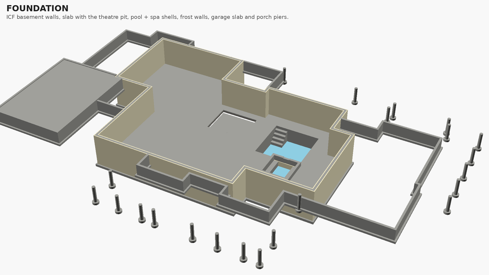
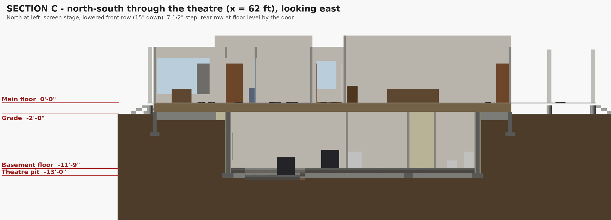

# House redesign (November 2026): model notes and build spec

The main floor and the basement were redrawn. The plans are
[`main_floor.jpg`](main_floor.jpg) and [`basement.jpg`](basement.jpg); the
Oct 30 [`floor_plan.JPEG`](floor_plan.JPEG) is the version before them.
This document covers:

1. how the plans were turned into the OpenSCAD model, and what changed on the way;
2. the stair between the floors;
3. the foundation;
4. the concrete for the indoor pool and the hot tub that spills into it;
5. the stadium-tiered home theater floor;
6. the open questions.

The site is rural Alberta (see
[`../House-Review-and-Research-2026-10-28.md`](../House-Review-and-Research-2026-10-28.md)).
Code references are to the National Building Code, Alberta Edition (NBC-AE), and to CSA A23.1.

> **Not construction documents.** The sizes below are a planning basis for
> quotes and for the engineer. Footings, the ICF walls, the pool and spa
> shell, and the depressed slabs all need a structural engineer's design.
> Concrete classes depend on a geotechnical report (sulphates, groundwater).
> Code values quoted from secondary sources are marked *verify* and must be
> checked against the current CSA A23.1 and NBC-AE text.

## 1. The model

| View | File |
|---|---|
| Main floor plan | [`main_floor_plan.png`](main_floor_plan.png) |
| Basement plan | [`basement_plan.png`](basement_plan.png) |
| Section A: east-west through the stair, theater and pool | [`section_a.png`](section_a.png) |
| Section B: along the stair | [`section_b.png`](section_b.png) |
| Section C: through the theater | [`section_c.png`](section_c.png) |
| Section D: through the pool and spa | [`section_d.png`](section_d.png) |
| Foundation alone | [`foundation.png`](foundation.png) |
| Both levels, apart | [`house_exploded.png`](house_exploded.png) |
| Outside | [`house_front.png`](house_front.png), [`house_back.png`](house_back.png) |

### 1.1 One coordinate frame for both floors

Both floors now share the main floor's coordinates, in feet:

- x runs east, with x = 0 at the garage's west wall.
- y runs north, with y = 0 at the front wall of the den and the breakfast bay.
- z = 0 is the finished main floor.

The main-floor plan reads at 15.2 px/ft and the basement sketch at
29.7 px/ft. The two are registered through the stair, the one element
that must line up. With that registration, every basement room comes out
within 1–2 in of its labelled size.

| Level | Elevation |
|---|---|
| Main floor (finished) | 0'-0" |
| Top of foundation walls (sill) | −1'-7½" (18" floor trusses + subfloor) |
| Grade | −2'-0" |
| Basement ceiling | 10'-0" clear (theater front tier: 11'-3") |
| Basement floor (slab top) | −11'-9" |
| Footing top / bottom | −12'-7" / −13'-5" (11'-5" below grade) |
| Theater front tier | −13'-0" |
| Pool water surface / pool floor | −12'-3" / −16'-9" |
| Spa rim / water / floor | −10'-3" / −10'-5" / −13'-11" |
| Bottom of the pool excavation | −18'-3" (16'-3" below grade) |
| Frost-wall footings | −6'-0" (4'-0" below grade) |

The floor-to-floor height is one parameter, `floor_to_floor()` in
`models/house_lib.scad`. It is 11.75 ft, which gives 10 ft basement
ceilings. The earlier research assumed 12 ft ceilings; for those, set it to
13.75. The basement rooms and the stair follow automatically: 22 risers of
7½", with the foot 2.6 ft further south, still in the hallway.

### 1.2 Changes from the drawings

1. **The stair** (section 2). It is drawn entered from the south on both
   floors, which no straight stair can do, and its box is about 9 ft long,
   too short for any basement stair. It now starts at the north end in the
   upper hall and runs 15'-9" south, under the main hall, to the basement
   hallway.
2. **Basement hallway**: 1.7 ft deeper, and the living room 1.7 ft shorter,
   so the foot of the stair has a proper landing.
3. **Basement doors**: the sketch has none, so 19 were added. Two to note:
   - the theater door swings out into the hallway, clear of the back row;
   - the pool room and the pool bath each open off the long hall.
4. **Main floor upper hall**: split at the sitting room / nook line by a
   wall with a 2'-8" door, as drawn.
5. **Master-suite double doors**: set where the plan shows them,
   1.3 ft west of the closet wall.
6. **Basement fixtures**: inset 6½" from the outside walls. The 13¼" ICF
   walls are thicker than the drawn walls.
7. **Furniture and fixtures** are illustrative: the plan's own, plus
   equipment in the utility and pool equipment rooms.

`tools/check_layout.py` checks both levels after every edit. It confirms:

- every door joins the rooms it should;
- every leaf swings clear of walls, fixtures, the theater seats and other leaves;
- every room is reachable;
- rooms neither overlap nor leave slivers between them.

## 2. Stair between the floors

| | Model | NBC-AE limit (stairs in a dwelling unit) |
|---|---|---|
| Rise | 19 risers × 7.42" (188 mm) = 11'-9" | ≤ 200 mm (7⅞") *verify* [S1] |
| Run | 18 treads × 10½" (267 mm) = 15'-9" | ≥ 255 mm (10") *verify* [S1] |
| 2R + T | 25.3" | comfortable range ~24–25½" (rule of thumb) |
| Clear width | 4'-2½" (1 286 mm) between walls | ≥ 860 mm |
| Headroom | ≥ 1 967 mm at the tightest point | ≥ 1 950 mm [S1][S2] |
| Handrails | both sides in the model | at least one side for > 2 risers; 865–965 mm high *verify* [S3] |
| Landings | top: the upper hall; bottom: the hallway, with 3'-9" before the living room opening | ≥ stair width, ≥ 900 mm long |

**Headroom.** Headroom is the tight dimension. The main hall's floor
(1'-7½" deep) crosses over the lower half of the flight. The floor opening
runs 11'-5" from the top nosing back to the main hall's north wall. That
keeps 1 967 mm of clear height under the floor edge, measured vertically
from the line of the nosings. The opening cannot get shorter without
cutting into the main hall.

**Width.** The stair is wider than 1 100 mm. Check NBC 9.8.7.1 to see
whether a second handrail is required at that width. The model draws one on
each side either way.

## 3. Foundation

Model: `models/foundation.scad`, and `mode = "foundation"` in
`models/house_combined.scad`. Alberta practice is in the research
document, §1.3–1.5.

### 3.1 Basement walls and footings

- **ICF walls:** an 8" concrete core with 2⅝" EPS on each face, 13¼"
  overall, running from the footing to the sill (about 11'-2" of wall).
  - Reinforcement follows the ICF maker's Canadian prescriptive tables or
    the engineer. For about 9½' of backfill this is typically 15M verticals
    and 15M horizontals in every course at 400 mm (16"); *engineer to
    confirm*.
  - Build in bucks for any basement windows (section 6).
- **Perimeter footings:** 24" × 10", on undisturbed soil 11'-5" below
  grade. Frost does not govern at this depth.
- **Interior bearing lines:** thickened-slab strip footings, 20" wide,
  under the main floor's bearing walls:
  - x = 54.14 ft, which is the theater, hallway and living room line;
  - x = 69.38 ft, the theater / pool room wall;
  - x = 96.33 ft, the pool room / pool equipment wall;
  - y = 18.15 ft, along the long hall.
- **Deepened footings round the pool room:** the pool pit is dug
  6½ ft below the basement footings, inside their 1:1 bearing zone. The
  model takes those footings down to the pit depth. The alternative is
  designing the pool shell to retain them; that is the engineer's call
  (section 4.5).
- **Theater pit:** the lowered front tier stops 1 ft short of the side
  walls and 2½ ft short of the screen wall (section 5). That keeps it out of
  the footings' 1:1 bearing zones, so no footing steps down for it.

### 3.2 Slab, insulation, radon

- **Slab:** 4" (100 mm) on 6" (150 mm) of clear crushed stone, over a
  sealed 10-mil poly vapour barrier taped to the walls.
- **Insulation:** 2" rigid insulation (EPS Type 2 or XPS) under the slab is
  worth it in zone 7A/7B. It is essential if the slab carries in-floor heat.
- **Radon (NBC 9.13.4):** Alberta adopts these provisions unchanged [S4][S5].
  - The clear stone is the gas-permeable layer.
  - Rough in a sealed, capped pipe through the slab to that layer.
  - The pool pit and the theater pit have their own stone beds, so connect
    them to the main layer with a pipe, or give them their own rough-in.

### 3.3 Waterproofing and drainage

Use the standard stack in research §1.5:

- membrane or dampproofing on the ICF;
- drainage board;
- weeping tile at the footings, to a sump;
- free-draining backfill.

The pool pit adds a second, deeper drain loop (section 4.4).

### 3.4 Concrete for the house foundation

| Element | CSA A23.1 class | Strength / max w/cm | Notes |
|---|---|---|---|
| Footings, ICF walls | S-class from the geotech report; else N | S-2: 32 MPa at 56 days, 0.45, HS/HSb cement [S6] *verify* | Alberta soils are often sulphate-bearing; the geotech report decides S-1/S-2/S-3 |
| Basement slab | N (interior, above the poly) | 25–32 MPa, ≤ 0.55 | Lower w/cm curls less; cure wet for 7 days |
| Garage slab | C-2 (de-icing salts drip off cars) | 32 MPa, 0.45, air-entrained *verify* | |
| Frost walls, porch piers | as the footings (S-class if sulphates) | air-entrained where exposed above grade *verify* | |

### 3.5 Where there is no basement

- **Frost walls:** 8" concrete on 20" × 8" footings with the bottom
  4'-0" (1.2 m) below grade, the Alberta minimum (research §1.4). They run
  under every main-floor outside wall that is not over the basement:
  - the bedroom wing;
  - the scullery;
  - the nook;
  - the office and master wing;
  - the den, foyer and breakfast-bay fronts;
  - the garage.

  They stop against the basement walls. The model's `frost_walls()` lists
  all 26 segments.
- **Crawlspace:** 18" clear under those parts of the main floor.
  Condition it as part of the house, with insulated frost walls and a
  sealed ground cover tied into the radon layer. That beats venting it in
  zone 7.
- **Garage:** a 4" slab on 6" stone. Its top is 18" below the house floor;
  the house door has a landing and two steps.
- **Porch posts:** 12" piers on 24" bells, 4½ ft below grade, or helical
  piles. The one post that stands on the basement wall needs no pier.

## 4. Pool and hot tub: the concrete

### 4.1 Geometry, as drawn on the basement plan

| | Pool | Spa (hot tub) |
|---|---|---|
| Inside size | 15'-0" × 15'-0" | 8'-0" × 8'-2" |
| Water depth | 4'-6" uniform (no diving) | 3'-6"; bench 21" below the water on three sides |
| Water level | 6" below the deck | rim 18" above the deck; water 2" below the rim |
| Water volume | 28.7 m³ (≈ 7 600 US gal) | 4.9 m³ (≈ 1 280 US gal) |
| Entry | four 12" steps in the NW corner, the top one 6" under water | over the rim |
| Join | the spa sits against the pool's south wall, flush with its east side | a 2'-0" spillway in the shared wall drops spa water into the pool |

### 4.2 Shell

- **Thickness:** 9" (230 mm) walls and a 10" (250 mm) floor. That is
  thicker than a typical backyard pool's 6–8". This shell sits beside
  basement footings and up to 6½ ft below the basement slab, and it must
  hold the soil when empty.
- **Construction:** wet-mix shotcrete per ACI 506.2 and the new ACI pool
  guide, ACI PRC-506.8-24 [S7][S8]. Form-and-pour cast-in-place concrete
  also works.
- **Strength:** specify **35 MPa (5 000 psi) at 28 days**. The shotcrete
  industry's floor for pool concrete is 28 MPa (4 000 psi) in place
  [S7][S9]. Specify above it for an indoor shell that is never allowed to
  leak into a basement.
- **Exposure class:** the water is chlorinated, or salt if a
  salt-chlorine generator is used, and the shell never freezes.
  - Treat the water face as chloride exposure: **max w/cm 0.40**,
    CSA C-1-level durability [S10] *verify*.
  - C-3, for continuously submerged concrete without freezing, may be the
    code-minimum class. The engineer can choose it, but keep 0.40.
  - No air entrainment is needed indoors.
  - Use the soil side's sulphate class (section 3.4) if the geotech report
    calls for one; HS/HSb cement then serves both faces.
- **Waterproofing:** a crystalline waterproofing admixture in the shell
  mix. Then a waterproof interior finish:
  - pool plaster or an aggregate finish; or
  - tile on a bonded waterproof membrane. Tile is a good choice for the
    spa and the spillway.
- **Reinforcement:** typically 15M at 300 mm (12") each way.
  - Double mat in the floor and in the pool walls.
  - Cover: 75 mm (3") on faces cast against soil, 50 mm (2") to the
    water face.
  - *Engineer to design*, including the spa walls standing 18" above the
    deck and the step-down where the spa floor meets the pool wall.
- **Quantity:** about **20 m³ (26 yd³) in place**:
  - pool walls 6.7 m³;
  - pool floor 6.4 m³;
  - pool steps 1.1 m³;
  - spa walls, floor and bench 6.5 m³;
  - less 0.6 m³ for the shared wall.

  Order 10–15 % more for shotcrete rebound and overspray.

### 4.3 The pool–spa join and the spillway

- **One continuous placement.** Shoot the pool, the spa and the shared wall
  in one placement, with no cold joints. Shotcrete placed this way bonds
  monolithically, and shared pool–spa walls are routinely built without
  waterstops [S11][S12].
- **Where a joint is unavoidable,** for example if the 18" of spa wall
  above the deck is shot later:
  - roughen and prepare the joint;
  - cast in a PVC or hydrophilic waterstop;
  - hire a crew that has done it before, because encapsulating a waterstop
    in shotcrete takes skill [S13].
- **The weir sets the spa's water level, not the tile line.** Survey the
  spillway lip to ±⅛". A notch set 2–3" high is a classic failure: it puts
  the spa's waterline into the tile and the coping [S14].
  - Finish the 2'-0" lip in stone or tile, with a drip edge, so the water
    sheets into the pool instead of dribbling down the wall.
  - The spa needs its own suction and returns, and a means to fill it above
    the spillway. Plumb the spa as the high body that overflows into the
    pool.

### 4.4 Below the shell: water, insulation, drainage

- **Groundwater.** The pit bottom is 16'-3" below grade. Before anything
  else, the geotech must establish the seasonal-high water table.
  - The design must resist uplift when the pool is drained. A drained shell
    in high groundwater can float.
  - Set a **hydrostatic relief valve** in the main-drain sump [S15][S16].
  - Keep it working; never drain the pool with the relief blocked.
- **Drain loop.** Run a perforated loop at the pit bottom in the 6" stone,
  tied to the house's weeping tile and sump.
- **Insulation.** 2" rigid insulation under the floor and around the
  walls below the slab: EPS Type 2 or XPS, rated well above the ~3 psi that
  the shell and water impose. Without it, the pool water heats the ground.
- **Plumbing:**
  - two main drains with ANSI/APSP-16 anti-entrapment covers, piped to the
    pool equipment room next door;
  - pressure-test all piping before the shoot;
  - fill-test the shell for about 7 days before finishes.

### 4.5 The room around it

- **Footings.** The basement footings round the pool room go down to
  the pit depth, or the shell is designed to retain them (section 3.1).
- **Dehumidification.** An indoor pool needs a dedicated pool dehumidifier
  sized on evaporation, holding 50–60 % RH. Run the room air 1–2 °C above
  the water and slightly negative to the house. A pool cover cuts the load
  sharply.
- **Envelope.** The ICF walls keep the cold side out of the wall
  assembly.
- **The main floor above.** The pool room ceiling (the main floor's
  underside) needs a vapour-tight, corrosion-safe finish. The great room,
  the main hall, the foyer and the den are above it.
- **Equipment room.** The pool equipment room needs ventilation and safe
  chemical storage.

## 5. Home theater: the stepped floor

### 5.1 Layout

A cinema-style stadium floor in the 14'-10" × 20'-6" room:

- **Rear tier** at the basement floor level, so there is no step at the
  door: 4 recliners, with a 2'-2" aisle by the door.
- **One 7½" step** with a 10¾" tread. The 15" total drop is split in two
  equal steps.
- **Front tier** 15" down, 9'-9½" deep and 12'-6" wide: 4 recliners.
- **Ledges** 1'-2" wide at floor level on each side, and a **2'-6" stage**
  at floor level under the screen. These keep the sunken slab clear of the
  footings (section 3.1).
- **Screen:** 120" 16:9 (8'-8¾" × 4'-10¾"), 18" above the floor, which is
  33" above the front tier.

### 5.2 Sightlines

Assumptions:

- seated eye height 40" above the seat's floor;
- top of head 4¾" above the eye;
- eyes about 11" in front of the seat backs.

| | Front row | Rear row |
|---|---|---|
| Eye elevation | 2'-1" (above the basement floor) | 3'-4" |
| Distance to the screen | 10.3 ft | 18.2 ft |
| Horizontal viewing angle | 46° | 27° |
| Look up to the screen centre | 10° | 2° |

**Check.** The rear row's sightline to the bottom of the screen passes
**5.4" above the front-row eye**, clearing a 4¾" head. That gives every-row
vision: each rear seat sees the whole screen over the head in front.

**Riser.** The minimum riser for that is 13.8"; 15" is provided.

**Trade-off.** Raising the screen bottom to 24" would cut the riser needed
to about 9". The cost is a front row looking up more steeply.

**The C-value method.** C is the height of the rear sightline above the
front spectator's eye. It is the standard way to size risers [S17].
- Here it is set to the eye-to-head-top distance; that is every-row vision.
- SMPTE's withdrawn EG-18 used 9–10" for a more generous margin [S18].
- Theater-seating suppliers quote 12–18" risers for two rows [S19].

### 5.3 Construction

- **Depressed slab:** form the step and the front tier as a depressed slab
  in the basement pour.
  - 4" slab on 6" stone at −15".
  - Thicken (turn down) the slab edges at the pit's sides.
  - Carry the poly and the radon stone layer continuously into the pit, and
    connect them (section 3.2).
- **Structure overhead:** the ceiling is the main floor's trusses, under
  the flex room, the upper hall and the main hall. The pit gains 1'-3" of
  height at the front.
- **Sound isolation:** build it as a room within a room:
  - double drywall with damping compound on isolation clips and channel,
    on the walls and on a ceiling hung under the trusses;
  - a solid-core door with perimeter seals;
  - lined, baffled duct runs.
- **Neighbours:** the bath, gym, hallway, pet room and pool room share its
  walls. The music room is next door to the gym, so isolate it the same
  way.
- **Cheaper alternative:** build a framed 15" riser on a flat slab. This
  needs no depressed concrete, but it puts a step at the door and leaves the
  rear row 8'-9" of headroom.

## 6. Open questions for you

1. **Basement egress and daylight.** The basement sketch has no windows or
   outside door. With no basement bedrooms the NBC does not require an
   egress window. Even so, a pool room, gym, theater and music room
   deserve:
   - at least one egress-size window in a window well, or an exterior
     stair out of the basement (the previous design had one);
   - some daylight.

   Window bucks have to go into the ICF before the pour.
2. **Utility tunnel to the shop.**
   - The shop plan (`docs/shop/Shop-Base-Plan.md`, `models/site.scad`)
     brings the tunnel due south on x = 80 into the old basement's
     north-side UTILITIES room.
   - The new basement's UTILITY room is on the west side, 14'-6" × 7', and
     on x = 80 the north wall is now the pool room's.
   - The site model draws the tunnel to that wall so the conflict shows.
     Its landing needs re-planning: move the tunnel, or move a utility
     room to the north wall.
   - The site and shop renders in `docs/shop/` still show the old house.
3. **Deck access.** The plan shows no door from the great room or the
   breakfast nook onto the north deck; the deck is reached only by its
   steps.
4. **Basement height.** It is 10 ft clear here, against 12 ft in the
   earlier research. That is one parameter (section 1.1).
5. **Geotech first.** These all hang on the report:
   - sulphate class (cement type);
   - seasonal-high groundwater against a pool pit 16 ft down;
   - bearing capacity for the deepened footings.

## Sources

- [S1] Canada stair code summary (NBC 9.8: rise, run, headroom): <https://stairscalc.pages.dev/stair-code-requirements/canada>
- [S2] BC Building Code 9.8 excerpt (1 950 mm headroom in dwelling units): <https://www.bcpublications.ca/civix/document/id/bcbc2012/bcbc2012/ep001029.3>
- [S3] Rocky View County (Alberta), handrails in dwelling units: <https://www.rockyview.ca/Portals/0/Files/BuildingPlanning/Building/Guideline-Handrails-Dwelling-Units.pdf>
- [S4] Canadian Contractor, provinces adopting NBC 9.13.4 radon provisions without variation: <https://www.canadiancontractor.ca/features/unintended-consequences-quest-for-energy-efficient-homes-could-be-killing-canadians/>
- [S5] C-NRPP radon interpretive guide (NBC 9.13.4.2 / 9.13.4.3): <https://c-nrpp.ca/wp-content/uploads/2026/07/CNRPP-Bulletin-Radon-Document-Interpretive-Guide.pdf>
- [S6] Abridged CSA A23.1-04 exposure-class table (S-1 / S-2): <https://www.scribd.com/doc/282684746/Durability-of-concrete>
- [S7] American Shotcrete Association, 4 000 psi minimum for pool shotcrete: <https://shotcrete.org/faq-items/when-was-the-4000-psi-28-mpa-standard-set-for-shotcrete/>
- [S8] ACI PRC-506.8-24, *Shotcrete Use in Pool Construction—Guide*: <https://watershapes.com/?p=49783>
- [S9] ASA position paper, pool shotcrete strength: <https://shotcrete.org/wp-content/uploads/2020/01/ASAPositionPaper%5FPoolRec%5F1.pdf>
- [S10] Eng-Tips, CSA C-1 / C-2 w/cm limits: <https://eng-tips.com/viewthread.cfm?qid=474358>
- [S11] Shotcrete magazine, monolithic joints in pool shotcrete: <https://shotcrete.org/wp-content/uploads/2020/05/2014Fal_PoolRecShotcrete.pdf>
- [S12] Shotcrete magazine, interconnected pools built monolithic without waterstops: <https://shotcrete.org/wp-content/uploads/2025/03/Pool-and-Rec_Boundless-Waters.pdf>
- [S13] ASA FAQ, encapsulating waterstops in shotcrete: <https://shotcrete.org/faq-items/we-will-be-shotcreting-a-pool-and-the-designer-has-put-an-expansion-joint-in-the-pool-going-from-the-top-of-one-wall-through-the-floor-to-the-top-of-the-other-wall-it-also-shows-a-9-in-229-mm-poly/>
- [S14] WaterShapes, "High Waterlines, Bad Leaks" (raised-spa spillway levels): <https://watershapes.com/?p=38431>
- [S15] AstralPool, hydrostatic valve in the main drain: <https://www.astralpool.com/master/en/pool-shell-equipment/main-drains/main-drain-accessories/hydrostatic-valve.html>
- [S16] TMI Aquatics, why hydrostatic relief valves matter: <https://tmiaquatics.com/?p=5514>
- [S17] Sightline (architecture), the C-value: <https://en.wikipedia.org/wiki/Sightline_(architecture)>
- [S18] SMPTE EG 18 (withdrawn), theater design: <https://pub.smpte.org/doc/eg18/19940325-pub/eg0018-1994_withdrawn2003.pdf>
- [S19] Seatcraft, home-theater riser heights: <https://www.seatcraft.com/blogs/news/home-theater-seat-risers>
