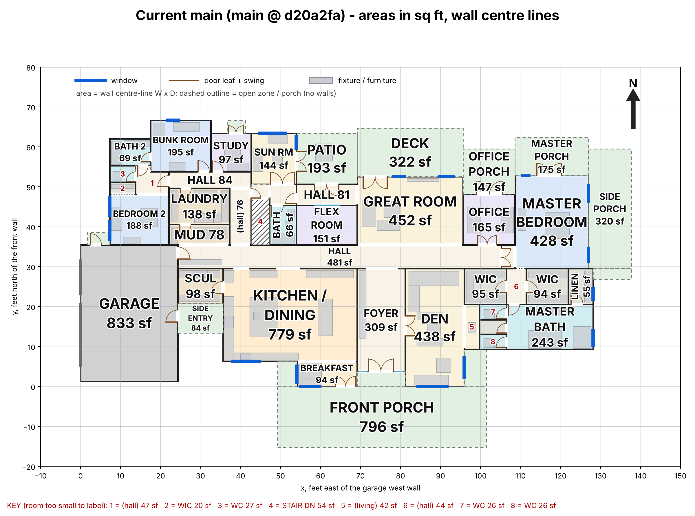
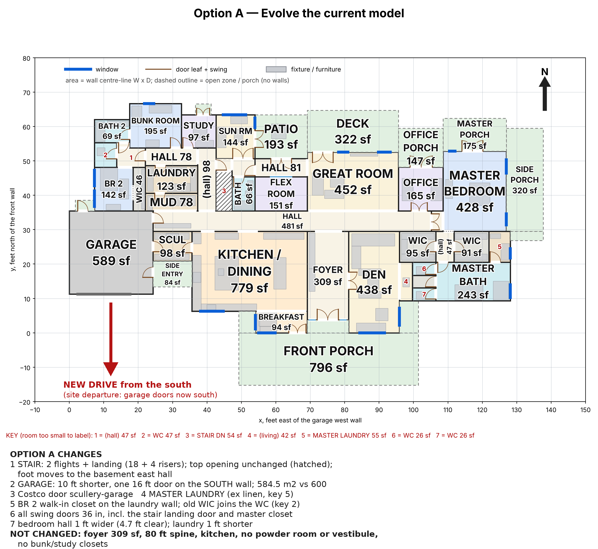
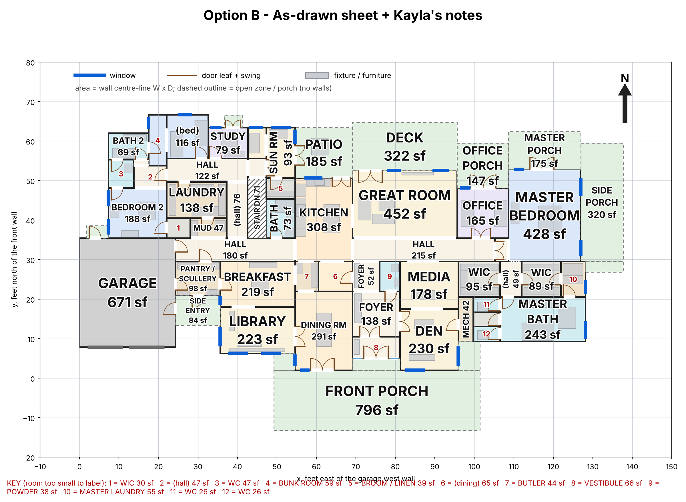
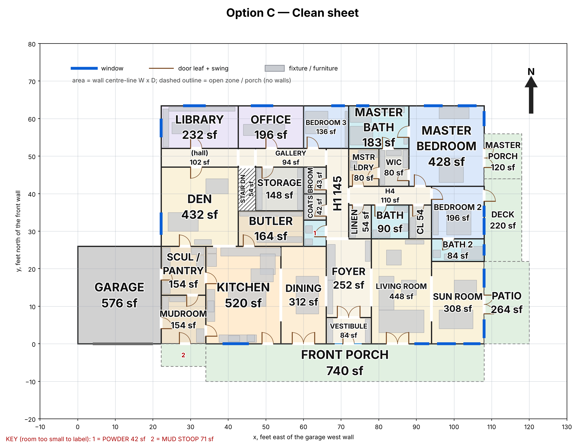

# Main-floor layout: decision pack (9 November 2026)

_For Jordan and Kayla. Three options for the new main floor, built on the review in PR #20 (`docs/house/House-Plan-Review-2026-11-09.md`)._
- **This pack recommends; it doesn't decide.** Nothing here changes the model on `main`. A later run turns the option you choose into the plan.
- **Same measuring stick for every column.** Each option is a SCAD model that passes `tools/check_layout.py` on both levels. The coordinator re-measured every number with the script used for the current model.

## The short version

| | **A: Evolve the current model** | **B: The as-drawn sheet + Kayla's notes** | **C: Clean sheet from Kayla's notes** |
|---|---|---|---|
| In one line | Smallest honest fix of today's plan | The architect's arrangement, with Kayla's notes applied | Re-planned from Kayla's notes, in a simpler block |
| Kayla's plan items in / missing / contradicted (of 164) | 76 / 79 / 9 | 98 / 63 / 3 | 112 / 50 / 2 |
| Her deal-breakers met (of 12) | 9 | 9 | **12** |
| Building area (limit 600 m²) | 584.5 m² | 585.7 m² | **575.3 m²** |
| Halls as a share of the floor | 16.6% | 13.6% | **8.7%** |
| Master bed → laundry | 42.9 ft | 31.5 ft | **24.9 ft** |
| What you give up | A garage bay, and most of Kayla's list stays unmet | Kitchen becomes the hallway between the wings; plumbing spreads out | A full redraw, a smaller master suite, a deeper plan |

**Ranked recommendation: 1. C, 2. B, 3. A.** C leads 6 of the 10 criteria outright and shares 2 more. B is second on Kayla's notes (98 plan items in, against C's 112 and A's 76). The reasoning, what C gives up, and the cheap hybrids are below. **The choice is yours.**

_Today's plan (the model on `main`), for reference._

3D views: [A](option-a-evolve-current/3d_a.png) · [B](option-b-as-drawn-plus-kayla/3d_b.png) · [C](option-c-clean-sheet/3d_c.png). Basement and stair: [A](option-a-evolve-current/basement_plan_a.png) · [B](option-b-as-drawn-plus-kayla/basement_plan_b.png) · [C](option-c-clean-sheet/basement_plan_c.png).

---

## The fixed matrix

Every number comes from the same script and the same method (`plan_facts.py` variant mode; coordinator re-runs in the run folder). **Bold** = best in the row (ties are all bolded; rows where every column is equal aren't bolded).

| Criterion | Current | A | B | C |
|---|---|---|---|---|
| **1. Kayla's notes:** plan items in / missing / contradicted (of 164), independent re-score | 62 / 89 / 13 | 76 / 79 / 9 | 98 / 63 / 3 | **112 / 50 / 2** |
| Same, as each designer scored it | — | 78 / 77 / 9 | 109 / 52 / 3 | 120 / 44 / 0 |
| Deal-breakers met (of 12), independent re-score | 5 | 9 | 9 | **12** |
| **2. Review Blockers fixed** (of B1–B6) | 0 | 2 (stair, area) | 2 (stair, area) | 2 (stair, area) |
| Basement Blockers B3–B6 (ICF walls, pool pit, pool floor, pool water) | open | open | open | open |
| Stair-door code miss (B7) | fails | fixed | fixed | fixed |
| Stair-top landing at least the stair's width (CODE-07) | no (975 mm) | no (3.39 ft vs 4.22) | designer to confirm | **yes (4.62 × 5.00 ft)** |
| **3. Circulation:** halls / halls + foyer, % of floor | 16.2 / 21.9 | 16.6 / 22.2 | 13.6 / 14.8 | **8.7 / 10.2** |
| **4. Plumbing:** drain-run index (ft) | **879** | 1,019 | 1,162 | 951 |
| Wet-wall groups (main) / stacked over the basement | 14 / 1 | 15 / 1 | 16 / 2 | **12** / 1 |
| Water heater → furthest fixture | 119.8 ft | 119.8 ft | 114.8 ft | **87.3 ft** |
| **5. Accessibility:** single doors under 32" / 32–35" / 36"+ | 7 / 11 / 4 | 0 / 0 / 23 | **0 / 0 / 30** | **0 / 0 / 30** |
| Narrowest hall (clear) | 3.71 ft | 4.71 ft | **4.95 ft** | 4.60 ft |
| No-threshold shower | no | no | on paper | **drawn flush** (engineer recess) |
| **6. Public/private and noise:** bedrooms sharing a wall with living rooms / bedroom next to the foyer | 0 / no | 0 / no | 0 / no | 0 / no |
| Master bed → laundry | 103.1 ft | 42.9 ft | 31.5 ft | **24.9 ft** |
| Two wings split by the great room (K-075) | yes | yes | yes | **no** |
| Main wing-to-wing route crosses the kitchen | **no** | **no** | yes (6 ft lane past the work zone) | **no** |
| Nearest bedroom to the existing west drive | 9.3 ft | 9.3 ft (south drive noted only) | 9.3 ft (south drive noted only) | **42.0 ft** |
| **7. Orientation and daylight:** master suite faces | E | E | E | **N + E** (K-013) |
| Bedrooms with east light | 1 of 3 | 1 of 3 | 1 of 3 | **2 of 3** |
| Living rooms with south exposure | den | den | library, den, dining | **living, sun room** (+ kitchen, dining) |
| Rooms with windows on 2+ walls | 4 | 4 | **5** | 3 |
| **8. Fit with the basement, shop and site** | — | stair foot moves (basement); south drive noted | stair room +25 sf (takes a gym corner); south drive noted | stair foot moves (same as A); new 85.8 × 63.4 ft block; crawl wings not built; south drive noted |
| Envelope: heated perimeter / corners | 395.5 ft / 30 | 395.5 / 30 | 390.1 / 30 | **298.5 / 4** |
| Garage (sf; bays) | 833; 3 (side-load) | 589; 2 (south) | 671; 2 (south) | 576; 2 (south) |
| **9. Building area** (outside face; margin under 600 m²) | 608.0 (8 over) | 584.5 (15.5) | 585.7 (14.3) | **575.3 (24.7)** |
| **10. Cost vs the current model** | — | $ down: garage −244 sf; a landing, a second W/D and 36" frames come back | $ down, small: −231 sf enclosed; two laundries, a powder room, a longer stair opening | $ down: ~97 ft less wall, 4 corners vs 30, −257 sf garage, no crawl wings. **Plus the cost of a full redraw.** |

**Leader on each criterion:**

| Criterion | Leader |
|---|---|
| 1. Kayla's notes | **C** (112 in, 12/12 deal-breakers) |
| 2. Review Blockers | Tie: B1 and B2 fixed in all, B3–B6 open in all. Only C also passes the stair-top landing (CODE-07). |
| 3. Circulation | **C** |
| 4. Plumbing | **C** among the options. Today's plan still has the lowest drain-run index. |
| 5. Accessibility | **C** (the wide-hall deal-breaker is met only in C; B ties on doors and has the widest hall) |
| 6. Public/private and noise | **C** |
| 7. Orientation and daylight | **C** on orientation; **B** on daylight (5 rooms with glass on 2 walls) |
| 8. Fit with what exists (basement, drawings) | **A** (least change) |
| 9. Building area | **C** |
| 10. Cost | **C** to build; **A** to redraw (least design work) |

---

## Ranked recommendation

### 1. C: clean sheet from Kayla's notes
**Why.** It wins the rows that matter most to the brief:
- **Kayla's notes:** 112 in / 50 missing / 2 contradicted, independently re-scored, with all **12** deal-breakers met. It's the only option that meets the closets-off-exterior-walls and wide-halls deal-breakers.
- **Halls:** 8.7% of the floor against 16.2% today, about 417 sf more usable floor in the same house.
- **The simplest envelope:** 4 corners instead of 30, and 97 ft less exterior wall. That's the strongest cost lever in COST-08: less framing, insulation and air sealing at corners, and a simpler roof.
- **The biggest building-area margin:** 24.7 m² under 600, so Part 9 survives real wall thicknesses and later tweaks.
- **Kayla's orientation:** the master suite faces north, the sun room south-east, living rooms south. The bedrooms sit 42 ft from the existing drive even if the drive never moves, and laundry is 25 ft from the master bed.

**What C gives up**, stated plainly:
- **A full redraw.** Every main-floor room is new. The permit drawing set, the engineer's framing concept and this review's room-level findings must be redone for C. **Now is the cheapest moment for that:** the engineer hasn't started, and the Part 9 decision has to come first anyway.
- **A smaller master suite:** one 80 sf walk-in instead of two (K-200), a 183 sf bath instead of 243, no separate WC rooms (K-227).
- **A deeper plan.** The 63 ft depth means the roof trusses need interior bearing walls; the engineer places them (the gallery and hall walls are the obvious lines). Kayla's own notes warn that square, deep plans have dark interiors (K-097, K-098). The living room and den each have glass on one wall only (K-064).
- **Plumbing still isn't tight:** a drain-run index of 951 ft, 8% longer than today's, though shorter than A or B.
- **A two-car garage** (22 × 26 ft) and **a 45 ft kitchen triangle** (K-261 asks for 26 ft).
- **Two contradictions of Kayla's notes:** from the foyer you look straight through the dining room into the kitchen (K-144, K-262; openings at x = 66 and x = 54 line up on y 10–18). It's a cheap fix on the drawing: offset one opening.

### 2. B: the as-drawn sheet + Kayla's notes
**Why second.**
- **Kayla's notes:** second (98 in / 63 missing / 3 contradicted). Independently, 9 of 12 deal-breakers: its closet against the garage wall, the 3.0 ft master entry, and a south drive that is only described in text all fail.
- **It keeps the envelope you've already drawn.** No new building shape, and the most rooms with two walls of glass (5).
- **It answers the parked A/B baseline question directly:** this is what the architect's sheet becomes with Kayla's notes applied.

**Why not first:**
- **The kitchen becomes the hallway** between the west and east wings: a 6 ft lane past the work zone (C2 in its own cons).
- **The worst plumbing:** drain-run index 1,162 ft, 32% over today.
- **The kitchen and great room still face north.**
- **Several rooms shrink:** study 79 sf, sun room 130 sf.

### 3. A: evolve the current model
**Why third.**
- **Least change.** The fastest path to permit, because the drawing set mostly stands.
- **It fixes both layout Blockers and the cheap deal-breakers:** stair, area, master laundry, Costco door, 36" doors.

**Why not higher:**
- **The most of Kayla's list stays unmet:** 76 / 79 / 9.
- **The 481 sf hall spine, the foyer, the kitchen and the daylight problems are untouched.**
- **It gives up the third garage bay** and 46 sf of Bedroom 2.
- **Its stair-top landing is still 253 mm short** of the stair's width (CODE-07).

---

## Cheap hybrids (parts that move between options without redesign)

| Hybrid | Why it's cheap | What it fixes |
|---|---|---|
| **A + B's entry** | B rebuilt the foyer zone (x 69–81, y 0–30) into a vestibule, a smaller foyer and a powder room. A has the same envelope at the same coordinates. | A's missing vestibule (K-041) and powder room (K-033, K-298). Costs one more wet group, far from the drain exit. |
| **Swap the stair** | A and C use an **identical** stair fix (18 + 4 risers, 4.4 ft landing, basement foot moved east). B's straight 11 + 11 works in any option that keeps the stair at x 42.65–47.27 (A or B). | Lets you pick the stair on its own merits: A/C's keeps the main-floor opening; B's lengthens it to 71 sf. |
| **Master laundry in today's linen room** | Same rectangle and wet wall in A and B (x 121.94–128.13). | K-036 at near-zero area in either. |
| **Garage trim** | All three move the garage doors south and trim depth. B's 6.65 ft is the smallest cut. | If the third bay matters, take the 600 m² margin from C's halls instead: C has 24.7 m² spare. |

**Not cheap** (it looks it, but isn't):
- **B's kitchen inside A** moves the kitchen to the middle of A's hall spine, re-plumbs it and re-routes the main hall.
- **A bigger master suite inside C** is boxed in by the rectangle; it would cost a bedroom or the office.

---

## What doesn't change with the choice

- **The basement Blockers.** B3–B6 (the ICF walls, pool pit, pool-room floor and pool water) stay open in every option. They are the engineer's and the permit office's, whatever the main floor looks like.
- **The drive.** All three options turn the garage doors south, which needs a south drive. None of them is drawn in `site.scad` yet. That's conflict C2 in the review; decide it with the layout.
- **The pre-pour items:** sewage ejector, sump discharge, routes outdoors for the mechanical rooms, the rough-in list.

## The choice, for Jordan and Kayla

1. **Which starting point:** the house you know (A), the architect's sheet with Kayla's notes (B), or Kayla's notes from scratch (C)? This also settles the parked "Kayla's layer vs as-drawn" question.
2. **Is a full redraw acceptable now?** C needs one. It costs the least before the engineer starts and the most after.
3. **The master suite:** is C's single walk-in and 183 sf bath enough, or must the suite stay the size it is in A and B?
4. **The garage:** all three go to two front-facing bays. Keep a third bay, and take the 600 m² margin from somewhere else?
5. **The kitchen:** in B it is the route between the wings. Acceptable?
6. **Any hybrid** from the table above?

**After you choose:** a later run builds the chosen option into `models/`, regenerates the drawing set, re-runs `check_layout.py`, and re-checks the review's room-level findings on the new plan.

---

## How this pack was made

- **Who built the options:** one designer (Sonnet) per option, two at a time, on the `layout-options` branch only. Each option folder holds:
  - `main_floor_<x>.scad` (+ `basement_<x>.scad`);
  - `check_layout.txt` (passes);
  - `plan_<x>.png`, `3d_<x>.png`;
  - `plan_facts_<x>.md`, `matrix_<x>.md`;
  - `PROS-CONS.md` (pros, cons, a 164-row Kayla table, Blockers, cost drivers, departures, what you give up).
- **Independent checks:** the coordinator re-ran the checker and the full matrix on each option. The numbers in this pack are from those re-runs; where a designer's figure differed (B's stacked wet groups, 1 vs 2), the re-run wins.
- **Kayla's notes:** the Architecture specialist who wrote the original 335-item cross-check re-scored all three options on the same 164 plan items, under one set of rulings (`kayla-rescore.md`):
  - a closet against the unheated garage counts as an exterior wall;
  - a south drive noted but not drawn doesn't count;
  - a kitchen crossing needs a clear lane outside the work zone.
- **Structure, gas, wiring:** every structural move is flagged for the licensed Alberta engineer. Nothing here is a stamped design.
- **Run notes:**
  - The session's usage limit paused the run twice (about 04:05–07:50 and 08:40–13:15 UTC).
  - PR #21 (the three options) was merged before this pack was finished. This pack lands as a fresh change on `layout-options`, restarted from `main`.
