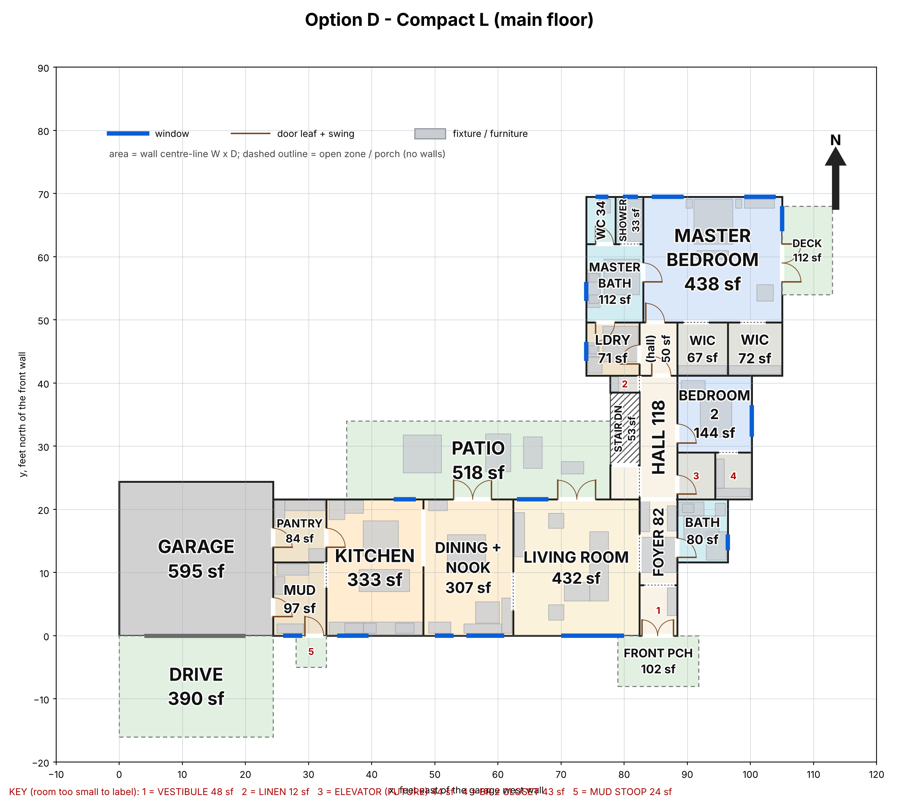
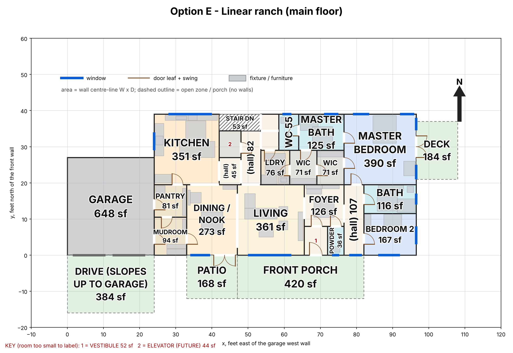
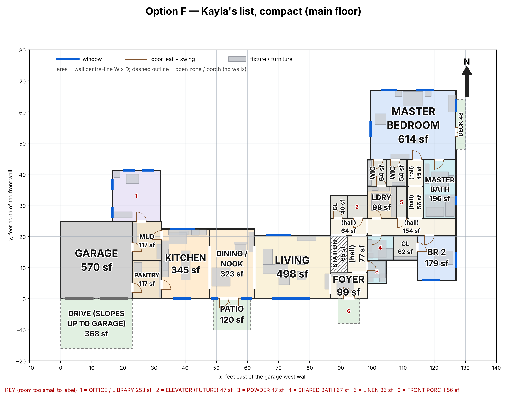

# Main floor under 3,000 sq ft: round-2 decision pack (11 November 2026)

_For Jordan and Kayla. Three main-floor options for the round-2 brief: a main floor of 3,000 sq ft or less excluding the garage, the primary and one more bedroom upstairs, the rest in the basement, and a stacked space for a future elevator._
- **This pack recommends; it doesn't decide.** Nothing here changes the model on `main`.
- **Same measuring stick for every column.** Each option is a SCAD model that passes `tools/check_layout.py` on both levels. The coordinator re-measured every number with the same script and method as round 1, and three independent reviewers checked each option (`review/`).
- **F is different on purpose.** D and E were drawn to fit under 3,000. F is Kayla's own Nov 11 room list, drawn at her sizes with no cap, to show what that list honestly needs.

<!-- option D: Compact L | option-d-compact-l -->
<!-- option E: Linear ranch | option-e-linear-ranch -->
<!-- option F: Kayla's list (Nov 11), compact | option-f-your-sizes-fitted -->
<!-- today-caption: Today's plan: 5,685 sq ft heated main floor (2,685 over the round-2 cap) · building area 608 m² (8 over the Part 9 limit) · one 4.19 m stair flight (code max 3.7 m) · halls 16.2% · Kayla: 62 in / 89 missing / 13 contradicted, 5 of 12 deal-breakers. -->

## The short version

| | **D: Compact L** | **E: Linear ranch** | **F: Kayla's list (Nov 11)** |
|---|---|---|---|
| In one line | A public wing and a bedroom wing, under the cap | One 73.5 × 40 ft rectangle, under the cap | Her room list at her sizes, no cap |
| Heated main floor (cap 3,000 sq ft) | **2,934** | 2,940 | 3,910 |
| Office/library | basement | basement | **main floor, 15 × 16** |
| Primary bedroom / living, clear sq ft (her list: 594 / 480) | 421 / 416 | 374 / 346 | **594 / 480** |
| Kayla's 164 plan items in / missing / contradicted (independent) | **101 / 60 / 3** | 99 / 62 / 3 | 84 / 73 / 7 |
| Her deal-breakers met (of 12) | 10 | **11** | 8 |
| The option's own review Blockers (plus one shared by all) | 1 | 1 | **0** |
| Basement ICF wall at the repo's price range | $110–158K | **$80–115K** | $146–209K |
| What you give up | The office on the main floor; a smaller primary and living; three closets on outside walls | Separation between kitchen, dining and living (fully open); south light in the kitchen (it faces north-west); a quiet bedroom 2 (the basement gym is under it) | The 3,000 cap (+910 sq ft); the dearest basement wall and longest drains; the open public wing |

**Ranked recommendation: 1. D, 2. E, 3. F.**
- D leads 3 of the 11 criteria outright (circulation, plumbing, public/private) and shares 4 more.
- E is the cheapest to build.
- F leads on your list, on daylight and on the hard code numbers, but it is 910 sq ft over the cap.

**The first decision is yours, and the pack can't make it:** the 3,000 cap and Kayla's Nov 11 list can't both hold (next section). The reasoning, what each option gives up, the hybrids and the questions for you are below.

3D views: [D](option-d-compact-l/3d_d.png) · [E](option-e-linear-ranch/3d_e.png) · [F](option-f-your-sizes-fitted/3d_f.png). Basements: [D](option-d-compact-l/basement_plan_d.png) · [E](option-e-linear-ranch/basement_plan_e.png) · [F](option-f-your-sizes-fitted/basement_plan_f.png). Today's plan: [main floor](../../review-agents/run-2026-11-09/renders/current_main_floor_plan.png).

## Your list, added up

Kayla's latest room list (11 November) adds up to **about 2,923 sq ft of floor inside the rooms**. That's the number in her planning notes, and it's correct for what it counts. A house also needs walls, halls, a stair, closets and the thickness of its outside walls. Option F draws her list at her sizes, as compactly as her arrangement allows (halls 10.7% of the floor, against 6.9% in D and 10.1% in E):

| Step | sq ft |
|---|---|
| Her rooms, inside the walls | 2,923 |
| Stair opening, elevator approach, bedroom 2 closet, linen | +130 |
| Interior walls (rooms measured to wall centre lines) | +183 |
| Halls: the junction, the bedroom hall, the primary's entry | +396 |
| Rooms a little over her sizes where the tiling needed it (foyer, ensuite, pantry turned) | +72 |
| Outside face of the outside walls (0.5 ft on 413 ft of perimeter) | +206 |
| **Heated main floor, as the 3,000 cap is measured** | **3,910** |

Source: `option-f-your-sizes-fitted/PROS-CONS.md` section 1; footprint re-measured by the coordinator (`coordinator-checks/matrix_f.md`).

**For comparison:** her Nov 10 sizes drew at **3,032 sq ft** as a plain bar (`matrix_f_nov10.md`). The 878 sq ft of growth since then comes mostly from:
- the shared office/library moving to the main floor (about 267 sq ft);
- the primary bedroom at 27 × 22 instead of 22 × 20 (about 165);
- the living room back to 24 × 20 from 20 × 20 (about 86);
- a separate powder room again (about 50);
- the L shape instead of a bar: 177 ft more outside wall and 171 sq ft more hall (about 260 together).

Smaller room changes make up the rest.

**What it takes to reach 3,000 from her list** (outside-face sq ft saved, from F's drawing, largest first):

| Move | Saves |
|---|---|
| Office/library to the basement | about 267 |
| Primary 27 × 22 to 22 × 22 | about 118 |
| The primary's own entry hall removed (door straight off the bedroom hall) | about 105 |
| Living 24 × 20 to 20 × 20 | about 86 |
| Powder merged into the shared bath (the brief allows it) | about 50 |
| Ensuite 16 × 10 to 13 × 10, laundry 9 × 10 to 8 × 9 | about 50 |
| Bedroom 2 12 × 14 to 12 × 12 | about 30 |

All seven together bring F to about 3,200. The last 200 needs the L to become a plain bar with halls near 7%. That is, it ends up close to what D and E already are. **The 3,000 cap and the Nov 11 list can't both hold.** That's the first decision below.

---

## The fixed matrix

Every number comes from the same script and the same method (`plan_facts.py` variant mode; coordinator re-runs in `coordinator-checks/`), or from the review findings named in the row. **Bold** = best in the row. Ties are all bolded; rows where every column is equal aren't bolded.

| Criterion | Today | D | E | F |
|---|---|---|---|---|
| **1. Size:** heated main floor, outside face, excl. garage (cap 3,000 sq ft) | 5,685 | **2,934** | 2,940 | 3,910 |
| Basement footprint (sq ft) | 3,617 | **2,934** | 2,940 | 3,917 |
| Building area with the garage (Part 9 limit 600 m²) | 608.0 (8 over) | **330.4** | 335.6 | 417.8 |
| **2. Kayla's notes:** plan items in / missing / contradicted (of 164), independent re-score | 62 / 89 / 13 | **101 / 60 / 3** | 99 / 62 / 3 | 84 / 73 / 7 |
| Same, as each designer scored it | — | 109 / 52 / 3 | 103 / 60 / 1 | 108 / 56 / 0 |
| Deal-breakers met (of 12), independent | 5 | 10 | **11** | 8 |
| **3. Review Blockers:** shared, the basement wall is 3.09 m against the ICF table's 3.0 m (CS-01) | open (3.70 m) | open | open | open |
| The option's own Blockers (code review; the other two reviews found none) | — | 1: bedroom 3's egress well under the deck (CS-03) | 1: stair headroom 1,894 mm against 1,950 (CS-02) | **0** |
| **4. Circulation:** halls / halls + foyer, % of floor | 16.2 / 21.9 | **6.9 / 8.7** | 10.1 / 11.9 | 10.7 / 13.4 |
| **5. Plumbing:** drain-run index, matrix point / a physical exit (ft; lower is better) | 879 / 747 | 587 / **486** | 667 / 500 | 1,017 / 916 |
| Wet-wall groups on the main floor / stacked over a basement group | 14 / 1 | 7 / **3** | 8 / 1 | 9 / 0 |
| Water heater → furthest main-floor fixture | 119.8 ft | 94.7 ft | **83.9 ft** | 114.8 ft |
| **6. Accessibility:** 1,700 mm turning circles, main floor / basement baths (ACC) | none shown | **5 of 5** / 1 of 2 | 5 of 6 / 0 of 1 | 6 of 7 / **1 of 1** |
| Narrowest hall (clear) | 3.71 ft | **5.60 ft** | 5.10 ft | 5.00 ft |
| Single doors under 32" / 32–35" / 36"+, main floor | 7 / 11 / 4 | 0 / 1 / 12 | **0 / 0 / 19** | **0 / 0 / 19** |
| Stair: one straight 19-riser flight; headroom at the end of the opening (min 1,950 mm) | one 4.19 m flight: fails | 1,980 mm (30 mm to spare) | 1,894 mm: fails as drawn | **2,001 mm** |
| Elevator space stacked on both floors, 5 × 5 ft approach | none | yes | yes | yes |
| Step-free house → garage | 3 steps | yes, if the garage floor slopes to its doors (CS-07) | same | same |
| **7. Public/private and noise:** primary bed → laundry | 103.1 ft | **23.5 ft** | 30.0 ft | 29.6 ft |
| Kitchen in view from the front door (ACC) | — | **no** | yes | yes |
| A bedroom next to or under a noisy room (ACC) | — | **none** | gym under bedroom 2 | basement bedroom 4 against the rec room; gym under bedroom 2 |
| **8. Daylight:** kitchen windows face | — | **N + S** | N + W | **N + S** |
| Rooms with windows on 2+ walls | 4 | 3 | 3 | **5** |
| **9. Kayla's Nov 11 list:** office/library | — | basement | basement | **main floor, 15 × 16** |
| Primary / living, clear sq ft (her list: 594 / 480) | — | 421 / 416 | 374 / 346 | **594 / 480** |
| A separate powder room (her list: 6 × 7) | — | no (the guest bath doubles) | 4.1 × 7.6 (fails the turning circle) | **6 × 7** |
| **10. Envelope and structure:** heated perimeter / corners | 399.5 ft / 30 | 311.8 / 14 | **227.0 / 4** | 413.2 / 24 |
| Longest roof truss span | — | **8.63 m** | 11.89 m, needs an interior bearing line (CS-08) | 8.72 m |
| **11. Cost vs today** (repo ranges only): basement ICF wall at $35–50 per sq ft of wall (HR:321) | 3,459 sq ft: $121–173K | 3,157: $110–158K | **2,298: $80–115K** | 4,184: $146–209K |
| Overall, by the cost review (PMC) | — | $$$ down | **$$$ down, the largest saving** | $$ down on the main floor; the basement wall goes up |

**Leader on each criterion:**

| Criterion | Leader |
|---|---|
| 1. Size | D and E (6 sq ft apart); F is 910 over by design |
| 2. Kayla's notes | **D** on plan items (101 in); **E** on deal-breakers (11 of 12) |
| 3. Review Blockers | **F** (only the shared wall item). D's and E's own Blockers are small plan moves. |
| 4. Circulation | **D** |
| 5. Plumbing | **D** (stacking, drain runs); E has the shortest hot-water run |
| 6. Accessibility | **D** on halls and main-floor circles; **F** on the stair and the basement bath. E's stair fails headroom as drawn. |
| 7. Public/private and noise | **D** |
| 8. Daylight | **F** (5 rooms with glass on 2 walls); D and F share the north + south kitchen |
| 9. Kayla's Nov 11 list | **F** |
| 10. Envelope and structure | **E** on the envelope; **D** on spans |
| 11. Cost | **E** |

---

## What the review panel found

Three read-only reviewers, findings in `review/`. Every code citation was re-run against the code library: code 45 of 45, accessibility 3 of 3, plumbing/cost 22 of 22.

| Review (Blocker / Should fix / Consider) | D | E | F |
|---|---|---|---|
| Code and structure (CS) | 2 / 6 / 6 | 2 / 6 / 7 | 1 / 7 / 9 |
| Accessibility, flow and Kayla's notes (ACC) | 0 / 4 / 8 | 0 / 5 / 5 | 0 / 7 / 3 |
| Plumbing, mechanical and cost (PMC) | 0 / 2 / 8 | 0 / 2 / 8 | 0 / 2 / 8 |

Findings shared by several options are counted in each column. Structural and gas items are review items for a licensed Alberta engineer. Wiring and gas details need a CEC / B149.1 check (those codes aren't in the library).

**The Blockers:**
- **All three (CS-01):** the basement wall from slab to main floor is 10.125 ft (3.09 m) against the ICF table's 3.0 m, with 2.97 m of backfill against its 2.85 m.
  - Either the wall gets an engineered design, or floor-to-floor drops from 11.75 to 11.46 ft.
  - At 11.46 ft the stair keeps 19 risers and the basement ceiling becomes 9.67 ft.
  - Round 1's STR-01 is smaller now (today's wall is 3.70 m) but not closed.
- **D (CS-03):** bedroom 3's only egress well sits under the primary's deck. Move the deck edge, or make bedroom 3's north window the egress window with its own well.
- **E (CS-02):** the stair headroom is 1,894 mm where 1,950 is needed. Lengthen the floor opening by about 0.45 ft; the kitchen is on the other side of that wall.

**The Should-fix items that matter most to the choice:**
- **D:**
  - three closets on outside walls (ACC-01);
  - three 34 in doors (ACC-05, a 0.2 ft fix each);
  - one basement bath short of a turning circle (ACC-03);
  - no vent openings drawn for the utility room, whose west wall is all garage (PMC-01);
  - the basement bath 2 drain runs 109 ft to the ejector pit (PMC-03).
- **E:**
  - the kitchen, dining and living are fully open (ACC-02);
  - the kitchen is in view from the foyer (ACC-07);
  - the basement gym sits under bedroom 2 (ACC-08);
  - the 39 ft roof span has no marked bearing line (CS-08);
  - the interior laundry's dryer vent runs 18.6 ft (PMC-06).
- **F:**
  - the public wing is fully open, and the kitchen is in view from the front door;
  - basement bedroom 4 shares a wall with the rec room (ACC);
  - 165 sq ft of the pantry and mudroom sit under no roof (CS-20, a drawing fix);
  - the stair-foot landing is 229 mm short (CS-19);
  - 7 of 9 drain lines are over 98 ft (PMC-13);
  - the utility louvres are below grade (PMC-14).

---

## Ranked recommendation

### 1. D: compact L

**Why first.** D is the best house under the cap.
- Its halls take 6.9% of the floor (E 10.1%, F 10.7%).
- It scores highest on Kayla's notes: 101 plan items in.
- It's the only option with the kitchen hidden from the front door and no bedroom next to or under a noisy room.
- The laundry is 23.5 ft from the primary bed.
- It stacks 3 of its 7 wet-wall groups over the basement.
- Its only own Blocker is the deck edge over bedroom 3's well, a small plan move.

<!-- giveup D -->
**What you give up with D:**
- The office/library on the main floor: it's in the basement.
- A primary of 421 sq ft and a living room of 416, against 594 and 480 on Kayla's list.
- A separate powder room: the guest bath doubles.
- Closets on inside walls: three touch outside walls, a deal-breaker, and moving them inboard costs footprint.
- About $30–43K: a 312 ft outline with 14 corners needs about 859 sq ft more basement wall than E (HR:321 range).
<!-- /giveup -->

**To fix on the drawing before choosing it:**
- the deck edge (CS-03);
- the three 34 in doors (ACC-05), which lifts D to 11 of 12 deal-breakers;
- the stairwell's north wall pushed 0.3–0.5 ft for headroom margin (CS-04);
- the basement bath 2 circle (ACC-03);
- the utility vents drawn above grade (PMC-01).

### 2. E: linear ranch

**Why second.** E is the cheapest to build.
- 227 ft of outline and 4 corners, against D's 312 and 14.
- One roof ridge.
- $30–43K less basement wall than D.
- It meets 11 of 12 deal-breakers.
- The shortest hot-water run (83.9 ft).

It ranks below D because its misses are layout, not detail:
- the kitchen, dining and living are fully open;
- the kitchen faces north-west;
- the basement gym sits under bedroom 2;
- its 39 ft roof span needs an interior bearing line the plan doesn't mark;
- its stair fails headroom as drawn (a 0.45 ft fix).

<!-- giveup E -->
**What you give up with E:**
- Separation between kitchen, dining and living: one 15 ft opening in a 19.5 ft wall (K-332, the deal-breaker E misses).
- South light in the kitchen: it has north and west windows.
- A quiet bedroom 2: the basement gym is under it.
- Room sizes: a primary of 374 sq ft and a living room of 346, the smallest of the three.
- The office/library on the main floor: it's in the basement.
<!-- /giveup -->

**To fix on the drawing before choosing it:**
- the stair opening, +0.45 ft (CS-02);
- a partial wall between dining and living, which is E's only missed deal-breaker;
- the bearing line at y = 19.5 (CS-08);
- the powder room width (ACC-04);
- the utility louvres above grade (PMC-02).

### 3. F: Kayla's list (Nov 11), compact

**Why third.** F is the honest size of the household's latest list, and it is the roomiest:
- the office/library on the main floor;
- a 594 sq ft primary and a 480 sq ft living room;
- 5 rooms with windows on 2 walls;
- the best stair headroom;
- no Blocker of its own.

It ranks third against this brief because:
- it's 910 sq ft over the cap;
- it has the dearest basement wall ($146–209K, $66–94K more than E);
- it has the longest drains (7 of 9 lines over 98 ft);
- it scores lowest on Kayla's notes (84 in, 8 of 12 deal-breakers).

Part of that score is fit-out the drawing left out (a drop zone, a pantry counter). Part is layout: the open public wing, and a basement bedroom against the rec room.

<!-- giveup F -->
**What you give up with F:**
- The 3,000 cap: 3,910 sq ft on the main floor, and a basement of the same size.
- Cost: the largest basement wall of all, 4,184 sq ft against today's 3,459.
- Short drains and stacked plumbing: none of its 9 wet-wall groups sits over a basement one.
- A closed-off kitchen: 14 ft openings run through the public wing.
- Four of Kayla's deal-breakers, as drawn.
<!-- /giveup -->

**If the cap moves:** start from F's room sizes, not its arrangement. F's designer estimates the same list as a plain bar at about 3,700 sq ft (not drawn).

---

## Hybrids (parts that move between options without a redesign)

1. **E plus one partial wall.** A wall between dining and living fixes K-332, the only deal-breaker E misses. It's nearly free on the drawing.
2. **D or E with the office/library upstairs.** That's the single biggest item on Kayla's list. It adds about 267 sq ft, which takes either to about 3,200, roughly 200 over the cap.
3. **F's room sizes on E's rectangle.** The designer's estimate is about 3,660–3,700 sq ft with about 7% halls. Not drawn.
4. **Any option at 11.46 ft floor-to-floor.** That brings the basement wall to the table's 3.0 m (CS-01), keeps the 19-riser stair, and gives a 9.67 ft basement ceiling.
5. **D's three local fixes** (the deck edge, the three doors, the stairwell wall) don't move any other room.

---

## What doesn't change with the choice

These hold for every option. They're decisions or checks for the next stage, not reasons to pick one layout over another.

- **The basement wall is 86 mm taller than the ICF table covers.** All three use 11.75 ft floor-to-floor, so the wall is 3.09 m against the table's 3.0 m, with 2.97 m of backfill against its 2.85 m (CS-01).
  - That still needs an engineered wall.
  - Or drop floor-to-floor to 11.46 ft: the stair keeps 19 risers and the basement ceiling becomes 9.67 ft.
  - Structural items are for a licensed Alberta engineer.
- **The step-free garage entry is the same trade in all three.** The garage slab sits at house level, so the garage floor must fall to its doors. Only one of the two house doors can then be truly flush, and the drive climbs about 9–12.5% over 16 ft (CS-07, ACC-13).
- **Every basement window is below grade.** Each needs a well about 6.5 ft deep, with a way to climb out, a drain and a cover that opens from inside (CS-15). Smoke and CO alarms are needed on every storey and near every bedroom (CS-16). The wiring needs a CEC check.
- **The future elevator** needs its floor opening framed now and a pit in the basement slab. The pit's depth, waterproofing and sump come from the chosen lift and the engineer; the repo has no price for them (CS-11, PMC cost table).
- **The mechanical room's vents** have to be drawn above grade and away from the garage (PMC-01, PMC-02, CS-18). The gas items need a B149.1 check.
- **The septic design flow falls below today's** in every option, and the tank clears the new walls by a wide margin (PMC-07, PMC-08).
- **All three stay in Part 9** (building area 330–418 m² against 600).

---

## The choice, for Jordan and Kayla

1. **The cap or the list?**
   - If 3,000 sq ft holds, the choice is D or E: the office goes to the basement, and the primary and living are 346–421 sq ft each (about 19–21 ft square).
   - If Kayla's Nov 11 list holds, plan on a main floor of about 3,700–3,900 sq ft with a basement to match. Start from F's room sizes on a tighter arrangement.
   - Every option below this one depends on that answer.
2. **The office/library: main floor or basement?** On the main floor it costs about 267 sq ft. It's the biggest single item between the list and the cap.
3. **How open should the kitchen, dining and living be?**
   - E is fully open: one 15 ft opening in a 19.5 ft wall.
   - F has 14 ft openings.
   - D separates the rooms with 9 ft openings.

   Which of these is the "broken-open" feel you want?
4. **An L or a rectangle?**
   - The L (D, F) keeps the bedrooms away from the living rooms.
   - The rectangle (E) is the cheapest to build: about $30–43K less basement wall than D.
5. **How big is the primary bedroom?** 27 × 22 (F), about 21 × 20 (D), or about 19 × 19.5 (E).
6. **The garage entry.** In all three, step-free means:
   - a garage floor that slopes to its doors;
   - a drive that climbs about 9–12.5% over 16 ft;
   - only one of the two house doors truly flush (CS-07).

   Is that the right trade against one or two steps?

---

## How this pack was made

- **Brief.** Round 2 started from Jordan and Kayla's 10 November direction:
  - a main floor of 3,000 sq ft or less excluding the garage;
  - the primary and one more bedroom upstairs, the rest in the basement;
  - accessibility, with room for a future elevator.

  The brief is `briefs/ROUND2-BRIEF.md`.
- **Options.** Three designer agents drew the options, one at a time or two at once:
  - **D** and **E** to the brief.
  - **F** to the household's own room lists:
    - first Nov 10 (3,032 sq ft, kept as a record);
    - then Kayla's Nov 11 list, which superseded it. Its first drawing (4,439, with a 95 ft gallery) was rejected as not compact, and the compact redraw is the one here.
- **Measuring.** Every number in the matrix was re-measured by the coordinator with the same script and the same outside-face method as round 1 (`coordinator-checks/`).
- **Review.** Three read-only reviewers checked all three options:
  - code and structure;
  - accessibility, flow and an independent re-score of Kayla's 164 plan items;
  - plumbing, mechanical and cost.

  Every code citation was re-run against the code library (`review/`).
- **Interruptions.** The session's usage limit stopped the run twice, on 10 November around 21:10 and 23:05 UTC. Each time the agents resumed from their saved state, and nothing half-written was committed.
- **Privacy.** The repo is public, so nothing from the household's private notes beyond room sizes and layout intent is in it.

