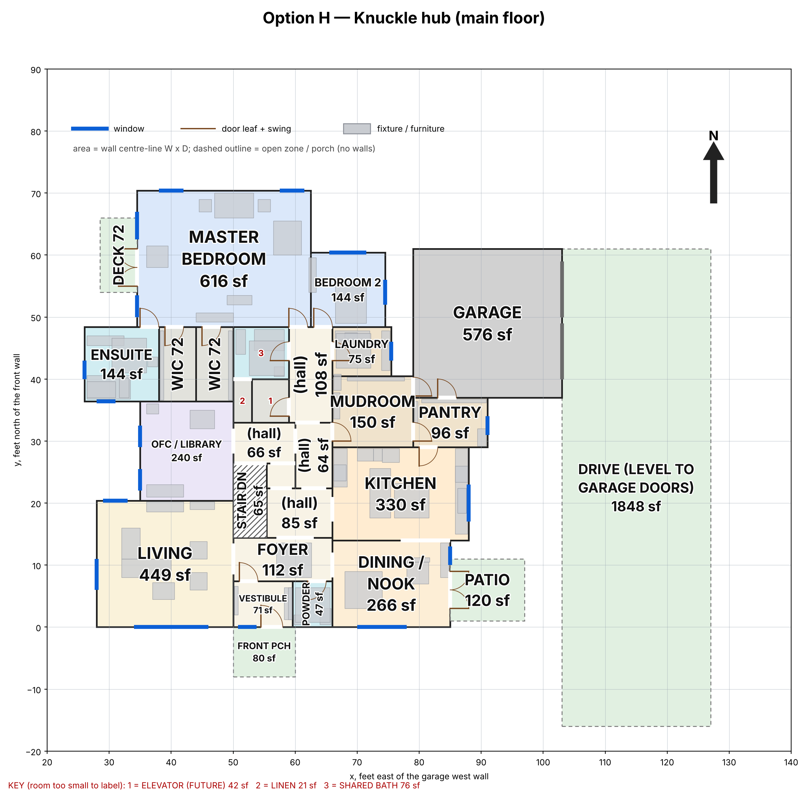

# A central-hub main floor: round-3 decision pack (12 November 2026)

_For Jordan and Kayla._ Round 3 answers two things Kayla said about round 2:
- "too much walking through all the living rooms";
- "I don't like them linear like that".

It keeps the library on the main floor and holds the main floor near 3,500 sq ft, as you chose.
- **This pack recommends; it doesn't decide.** Nothing here changes the model on `main`.
- **Same measuring stick as rounds 1 and 2.** The option is a SCAD model that passes `tools/check_layout.py` on both levels. The coordinator re-measured every number. Three independent reviewers checked it (`review/`).
- **One option this round.** Option G, a square pinwheel around the hub, was tried twice and doesn't fit your rooms near 3,500 sq ft (see "Why there's only one option"). Option H is compared with round 2's D (the round-2 recommendation) and F (Kayla's list drawn as one row), and with today's plan.

<!-- option H: Knuckle hub | option-h-knuckle-hub -->
<!-- today-caption: Today's plan: 5,685 sq ft heated main floor · halls 16.2% · 0 of 12 measurable trips cross a living room, but the walks total 778 ft · Kayla: 62 in / 89 missing / 13 contradicted, 5 of 12 deal-breakers. -->

## The short version

| | **H: Knuckle hub (round 3)** | D: Compact L (round 2) | F: Kayla's list (round 2) | Today |
|---|---|---|---|---|
| Daily trips that cross a living room (of 14) | **0** | 13 | 16 | 0 (12 measurable) |
| Walking on those 14 trips | **524 ft** | 653 ft | 850 ft | 778 ft |
| Living, dining and kitchen in a row you walk through | **no:** each opens onto the hub | yes | yes | no (long halls instead) |
| Library on the main floor | **yes, 15 × 16** | no (basement) | yes | yes (office) |
| Heated main floor, outside face | 3,571 sq ft | **2,934** | 3,910 | 5,685 |
| Kayla's 164 plan items in / missing / contradicted (independent) | 80 / 82 / 2 | **101 / 60 / 3** | 84 / 73 / 7 | 62 / 89 / 13 |
| Her deal-breakers met (of 12) | 10 (11 with a shelf moved) | 10 | 8 | 5 |
| Basement ICF wall at the repo's range | **$101–144K** | $110–158K | $146–209K | $121–173K |

**Recommendation: develop H.** It's the first plan in three rounds that meets both of Kayla's round-2 points at about 3,500 sq ft:
- **No daily trip crosses the kitchen, dining or living room.** That's 0 of 14, against 13 in D and 16 in F.
- **No row of public rooms:** the south front reads living | entry | dining, with the kitchen behind the dining room. Each opens onto the hub.
- **It plumbs best:** the shortest drain runs and the shortest hot-water run of the three.

**H isn't ready to become the model yet.** It needs one drawing pass on about a dozen fixes, mostly small, and three items for the engineer, listed below. It also scores below D on Kayla's original 164 notes (80 in against 101). Part of that is fit-out the drawing left out, such as drop zones, a pantry counter and closets, which the drawing pass can add.

**The choice is yours.** The questions are at the end.

3D view: [H](option-h-knuckle-hub/3d_h.png). Basement: [H](option-h-knuckle-hub/basement_plan_h.png). Round 2 for comparison: [D](../round-2/option-d-compact-l/plan_d.png) · [F](../round-2/option-f-your-sizes-fitted/plan_f.png).

---

## How H answers Kayla's two points

**1. No walking through the living rooms.**

`coordinator-checks/routes.py --extended` walks 14 daily trips through each plan's doors: the shortest path between room centres, through door midpoints. It then lists every living room a trip passes through (kitchen, dining, living, library).

| Trip | H | D | F |
|---|---|---|---|
| Garage → kitchen | 31 ft | 30 ft | 34 ft |
| Garage → primary | 67 ft | 125 ft, through kitchen, dining, living | 144 ft, through kitchen, dining, living |
| Front door → primary | 55 ft | 48 ft | 60 ft |
| Front door → kitchen | 23 ft | 50 ft, through living, dining | 53 ft, through living, dining |
| Front door → library | 33 ft | (basement) | 80 ft, through living, dining, kitchen |
| Primary → kitchen | 58 ft | 97 ft, through living, dining | 112 ft, through living, dining |
| Bedroom 2 → kitchen | 49 ft | 73 ft, through living, dining | 101 ft, through living, dining |
| Primary → laundry | 28 ft | 23 ft | 30 ft |
| Lift → kitchen | 34 ft | 63 ft, through living, dining | 78 ft, through living, dining |
| Lift → primary | 32 ft | 43 ft | 46 ft |
| Front door → living | 19 ft | 14 ft | 19 ft |
| Front door → dining | 18 ft | 32 ft, through living | 38 ft, through living |
| Kitchen → living | 40 ft | 36 ft, through dining | 34 ft, through dining |
| Dining → living | 37 ft | 19 ft | 20 ft |
| **Total / living rooms crossed** | **524 ft / 0** | 653 ft / 13 | 850 ft / 16 |

The accessibility reviewer checked these by eye on the plan and added 22 more trips; none crosses a living room in H. Measured from the front door itself rather than the foyer, H's walks are 441 ft on the first 10 and 567 ft on all 14. That's just over the brief's 420 / 560, by the length of the vestibule (ACC-01).

**2. Not linear.** The living room, the dining room and the kitchen each open straight onto the hub. The south front is living | entry | dining, not a 60–70 ft row. The quiet wing (primary, bedroom 2, shared bath, laundry) sits behind one 15 ft bedroom hall. Kayla's no-full-open-concept deal-breaker (K-332) is met.

---

## The fixed matrix

Every number comes from the coordinator's re-runs (`coordinator-checks/`) or the review finding named in the row. **Bold** = best in the row. Ties are all bolded; rows where every column is equal aren't bolded.

| Criterion | Today | D | F | H |
|---|---|---|---|---|
| **1. Kayla's round-2 points:** daily trips crossing a living room (of 14) / total walk | 0 of 12 / 778 ft | 13 / 653 ft | 16 / 850 ft | **0 / 524 ft** |
| Library on the main floor | yes (office) | no | yes | yes |
| **2. Size:** heated main floor, outside face, excl. garage (sq ft) | 5,685 | **2,934** | 3,910 | 3,571 |
| Basement footprint (sq ft) | 3,617 | 2,934 | 3,917 | **2,551** (under 71% of the main floor; CS-03) |
| Building area with the garage (Part 9 limit 600 m²) | 608.0 | **330.4** | 417.8 | 388.3 |
| **3. Kayla's notes:** plan items in / missing / contradicted (of 164), independent | 62 / 89 / 13 | **101 / 60 / 3** | 84 / 73 / 7 | 80 / 82 / 2 |
| Deal-breakers met (of 12), independent | 5 | **10** | 8 | **10** (11 with the pantry shelf moved, ACC-02) |
| **4. Review Blockers:** the option's own, plus the shared basement wall (CS-01) | — | 1 + 1 | **0** + 1 | **0** + 1 |
| **5. Circulation:** halls / halls + foyer, % of floor | 16.2 / 21.9 | **6.9 / 8.7** | 10.7 / 13.4 | 9.9 / 12.0 (15.6 counting every hub piece) |
| **6. Plumbing:** drain-run index, matrix point / a physical exit (ft) | 879 / 747 | 587 / 486 | 1,017 / 916 | 597 / **424** |
| Water heater → furthest main-floor fixture | 119.8 ft | 94.7 ft | 114.8 ft | **83.1 ft** |
| Dryer to an outside wall | 23.7 ft | 1.8 ft | — | **1.4 ft** |
| **7. Accessibility:** 1,700 mm turning circles, main floor | none shown | **5 of 5** | 6 of 7 | 5 of 7 (powder, laundry fail, ACC-03) |
| Narrowest hall (clear) | 3.71 ft | **5.60 ft** | 5.00 ft | **5.60 ft** |
| Stair headroom (min 1,950 mm) | one 4.19 m flight: fails | 1,980 mm | **2,001 mm** | **2,001 mm** |
| Elevator space: stacked; distance to the basement ICF wall (pit) | none | yes; 2.0 ft | yes; 0 ft | **yes; 6.6 ft** |
| **8. Public/private:** primary bed → laundry | 103.1 ft | **23.5 ft** | 29.6 ft | 27.8 ft |
| Closets on outside walls | 2 | 3 | 3 | **0** |
| **9. Daylight:** rooms with windows on 2+ walls | 4 | 3 | **5** | **5** |
| The hub's own daylight | — | — | — | front-door sidelight only; the clerestory isn't real as modelled (CS-04, ACC-04) |
| **10. Envelope:** heated perimeter / corners | 399.5 ft / 30 | 311.8 / **14** | 413.2 / 24 | **288.8** / 22 |
| Longest roof truss span | — | **8.63 m** | 8.72 m | 11.40 m, needs an interior bearing line (CS-09) |
| **11. Cost** (repo ranges only): basement ICF wall at $35–50 per sq ft of wall (HR:321) | 3,459 sq ft: $121–173K | 3,157: $110–158K | 4,184: $146–209K | **2,873: $101–144K** |
| Items with no repo price | — | — | — | the bedroom wing's unexcavated edge (1,017 sq ft, 124.5 ft of frost wall); the 1,848 sq ft drive |

**Where H leads:** Kayla's two round-2 points, plumbing, closets, envelope length and the basement wall. **Where D leads:** her original 164 notes, circulation, size, and roof spans. **F** leads nowhere outright.

---

## What the review panel found

Findings are in `review/`. Every code citation was re-run against the code library: code 40 of 40, accessibility 3 of 3, plumbing/cost 20 of 21.
- The 21st plumbing row cites page 37 of the sewage standard. That page continues the fixture-unit list of Table 2.2.2.2.A without printing the table number, so the checker can't match the article. The quote matches the page word for word.
- Structural and gas items are review items for a licensed Alberta engineer. Wiring and gas details need a CEC / B149.1 check.

| Review (Blocker / Should fix / Consider) | H |
|---|---|
| Code and structure (CS) | 1 / 10 / 8 (the Blocker is CS-01, shared with every option) |
| Accessibility, flow and Kayla's notes (ACC) | 0 / 9 / 8 |
| Plumbing, mechanical and cost (PMC) | 0 / 2 / 13 |

---

## Before H becomes the plan: the fix list

**Drawing fixes.** None moves the hub, the wings or the rooms around it.
1. **Make the hub's daylight real.** Raise the hub roof enough for a true clerestory, or add a skylight (CS-04, ACC-04). As modelled, the raised roof gives about 0.4 ft of glass.
2. **Open the basement stair foot.** Its only door misses the stair (CS-02).
3. **Clear the pantry's Costco door.** A 7 ft shelf runs across it (ACC-02), and fixing it restores the 11th deal-breaker.
4. **Give the powder room and the laundry a 1,700 mm turning circle.** They're 4.81 ft and 5.40 ft now (ACC-03).
5. **Library:** add the closable partition and a door to the hub, and put a window in each half (ACC-08).
6. **Bedroom 2's east window** looks at the garage wall 4.1 ft away. Move it to the north or shift the garage (ACC-06).
7. **Mudroom-to-garage door:** it's wedged into a corner 0.1 ft from the garage wall (CS-07). Also, only one of the two garage doors can be flush on a sloped garage floor (CS-06).
8. **Sight lines:** the foyer opens straight into the living room, dining and kitchen. Tighten the openings (ACC-05).
9. **Ensuite:** a real shower of at least 60 × 48 beside the tub (ACC-07).
10. **Bedroom 3's egress well:** 0.5 ft wider (CS-11). Draw closets in basement bedrooms 3 and 4 (ACC-16).
11. **Utility vents:** take them out through the rim joist, above grade and away from the ensuite window. The louvres are below grade with no wells (CS-10, PMC-01).
12. **Fit-out:** a drop zone in the mudroom, a pantry counter, deeper coat storage (ACC-11).

**For the licensed engineer, before the layout is fixed:**
- **The basement wall** is 3.09 m against the ICF table's 3.0 m (CS-01, shared by every option). Either it gets an engineered design, or floor-to-floor drops from 11.75 to 11.46 ft: the stair keeps 19 risers and the basement ceiling becomes 9.67 ft.
- **The bedroom wing has no basement under it:** 1,017 sq ft, with the floor about 4.5 in above grade (CS-03, PMC-02). It needs a frost wall and a retaining edge, which aren't priced; built in ICF that's about $19–27K (an illustration). The alternative is to extend the basement under the wing, which adds basement area.
- **The quiet wing's roof trusses span 11.40 m,** beyond the 9.8 m the lintel table assumes. Add an interior bearing line (CS-09).

---

## The future elevator: build the space now, install later

You've said the plan is to build the space now and install the lift when you need it, keeping the stairs as the backup. H already reserves the stacked 6 × 7 ft space:
- on both floors at the same spot, as two closets until then;
- off the bedroom hall, one opening from the hub;
- 6.6 ft from the basement wall, so a pit won't hit the footing.

The cost review lists what is far cheaper to do at build time than as a retrofit (`review/r3-plumbing-mech-cost.md`, "Future elevator"). Four of these **aren't yet in H's model, and can't be done cheaply once the trusses, slab and roof are in:**

| Do at build time | Status in H | Why now |
|---|---|---|
| Framed floor opening (trusses laid out around the shaft) | not drawn | Cutting through finished open-web trusses means retrofit headers |
| Pit or slab recess at the basement stop | not drawn | Forming it before the slab pour is cheap; cutting a finished slab, vapour barrier and radon layer is not |
| Pit drain / sump | not drawn | It's under-slab plumbing; it goes in before the pour |
| Headroom over the shaft | 0.5 ft as drawn (CS-05) | Raising the roof there is a framing change now and a re-roof later |

The cheap ones, also at build time:
- blocking and outlets in the stair walls for a stair lift or second handrail;
- a conduit sleeve and a spare breaker space (needs CEC check);
- framing the shaft walls and door headers to the supplier's rough opening;
- leaving a closet free for a controller cabinet if the chosen lift needs one.

**The repo has no elevator price**, so every item is "needs a quote". **Get the lift supplier's rough-in sheet before the engineer starts.** It sets the pit depth, the overhead, the door size and whether a machine space is needed.

---

## What H gives up

<!-- giveup H -->
- **A smaller house.** H is 637 sq ft more main floor than D, for the library upstairs and Kayla's room sizes.
- **Hall space.** The hub and its short halls take 12.0% of the floor with the foyer, or 15.6% counting every piece, against D's 8.7%.
- **Kayla's original notes.** H has 80 of the 164 items in, against D's 101. Part of the gap is fit-out the drawing pass can add.
- **A full basement.** The bedroom wing sits on a frost wall, not over basement; the alternative is more basement.
- **A short drive.** The garage sits north-east, with a 1,848 sq ft drive down the east side.
- **Laundry beside a walk-in.** The laundry is on the bedroom hall, 27.8 ft from the primary bed, as in Kayla's latest planning.
<!-- /giveup -->

---

## Why there's only one option this round

Option G was the square "pinwheel": four room groups wrapped around a central hub in a block about 58 × 58 ft. It was tried twice: a hand layout, then a skeleton with relaxed rules. Neither closed.
- **Arms vs the suite:** at about 3,500 sq ft, each of the four arms is about 22 × 36 ft (792 sq ft). The bedroom suite alone needs about 1,245 sq ft at centre lines: a 27 × 22 primary, the ensuite, two walk-ins, bedroom 2, a bath, the laundry and a short hall.
- **Fitting it breaks the size:** making room for the suite pushes the block past the 3,650 sq ft ceiling.

The central hub works for your room sizes when the bedrooms get their own wing, which is H. G's record is `option-g-pinwheel-hub/README.md`.

---

## The choice, for Jordan and Kayla

1. **Is H the direction?** If yes, the next run is the drawing pass (the 12 fixes), a re-check, and then H can become the model on `main`. If not, say what feels wrong on the plan; a sketch on it helps most.
2. **The bedroom wing: frost wall or basement under it?** As drawn, there's no basement under the wing: less digging, but an engineered edge. Or the basement extends under it: about 1,000 sq ft more basement, more storage, more cost.
3. **The hub's daylight: a raised clerestory or skylights?**
4. **The garage: north-east as drawn, with a long east drive, or closer to the road?** Moving it changes the mudroom/pantry corner.
5. **The laundry: on the bedroom hall (as now, and in Kayla's latest planning), or beside a walk-in** (her earlier must-have, K-036)?
6. **The elevator: do the four build-time items** (floor opening, pit, pit drain, headroom), with a supplier's rough-in sheet first?

---

## How this pack was made

- **Brief.** Round 3 started from Kayla's verdict on round 2 and your choices: the central-hub shape, about 3,500 sq ft, and the library, primary and kitchen kept at her sizes. The brief is `briefs/ROUND3-BRIEF.md`; it also builds in every recurring round-2 review finding.
- **The yardstick.** `coordinator-checks/routes.py` turns "walking through the living rooms" into a number: 14 daily trips, with every living room each crosses. The baseline for D, E and F is in `coordinator-checks/routes_baseline.md`.
- **Options.**
  - **Two designers worked in parallel.** G (pinwheel) was stopped after two attempts.
  - **H was drawn, then revised once** against the coordinator's check. The first draft still sent the dining room's trips through the kitchen, which is why the yardstick grew from 10 trips to 14.
- **Review.** Three read-only reviewers checked H: code and structure; accessibility, flow and an independent re-score of Kayla's 164 notes; plumbing, mechanical and cost, including the future elevator. The coordinator re-ran every citation and every footprint.
- **Interruptions.** The session's usage limit stopped two reviewers once, on 11 November around 19:35 UTC. They resumed from their saved state after the reset, and nothing half-written was committed.
- **Privacy.** The repo is public. Nothing from the household's private notes beyond room sizes and layout intent is in it.
